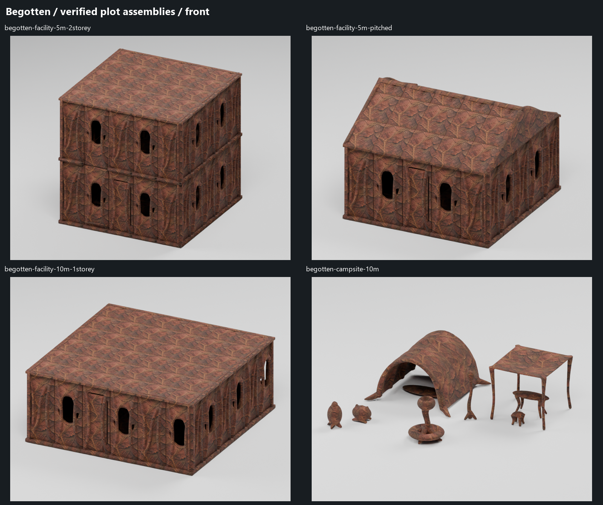
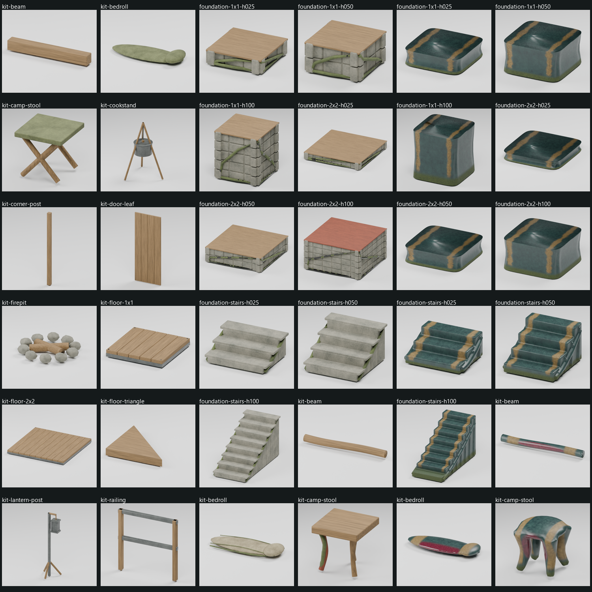

# Construction test image gallery

1568 original PNG renders and contact sheets. All four test views are included where generated: front, rear, closeup and neutral clay.

Private car/character reference renders and comparison panels containing them are excluded. Earlier studies remain visible; gallery inclusion does not imply approval.

Review labels: **ROUGH_STAGE_PASS** = current image and model hashes match a passing rough-stage review/gate; **REJECTED** = retained failed study; **UNREVIEWED** = rendered but no matching pass; **OVERVIEW_OR_HISTORICAL_STUDY** = contact sheet, guide or older study. These assets still require final art and game integration review.

[Machine-readable manifest](manifest.json) · [Filterable local gallery](index.html)

The HTML gallery runs locally after cloning: `python -m http.server 8000`, then open `http://localhost:8000/docs/asset-gallery/`.

Update and publish from the authoring workspace after each render batch: `python tools/build_asset_gallery.py --publish`. This preserves superseded renders, commits only gallery files and its verification workflow, and pushes the current branch. `--check` verifies source coverage and checksums; `--verify-archive` verifies a GitHub clone without ignored authoring sources. GitHub Actions runs the archive check on gallery changes.

## Construction plot guides

3 images · [Full image index](construction-plots.md)

## Faction structures and earlier studies

201 images · [Full image index](faction-structures.md)

## Unraveled snap construction

137 images · [Full image index](snap-kit.md)

## Penitent snap construction

137 images · [Full image index](penitent-snap-kit.md)

## Begotten snap construction

137 images · [Full image index](begotten-snap-kit.md)

## Faction foundations and stairs

133 images · [Full image index](faction-foundations.md)

## Production machinery and surface placeables

157 images · [Full image index](production-kit.md)

## Construction material revision 2

451 images · [Full image index](material-refresh.md)

## Weapon refinement and retained failed studies

212 images · [Full image index](weapon-refinement.md)

## Superseded renders

97 earlier test images retained. [Browse the history gallery](history.md).
