# Begotten model-specific surface studies

[Back to gallery](README.md)

| Image | Asset / view | Review status | Pixels |
|---|---|---|---|
| [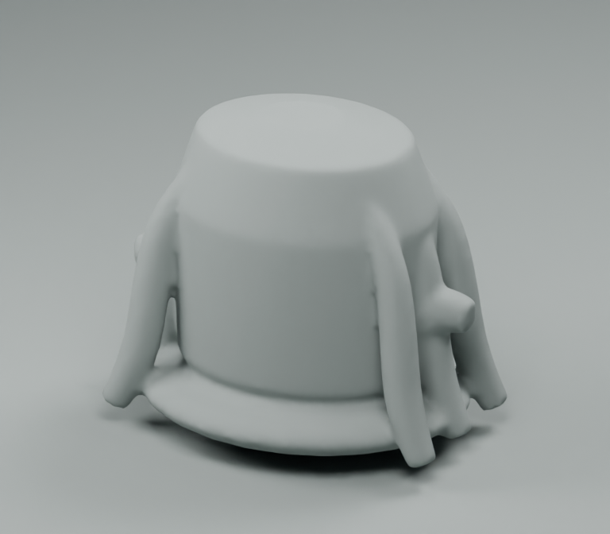](images/begotten-surface-pilots/begotten-dry-storage/clay.png) | begotten-dry-storage / clay | REJECTED | 768×672 |
| [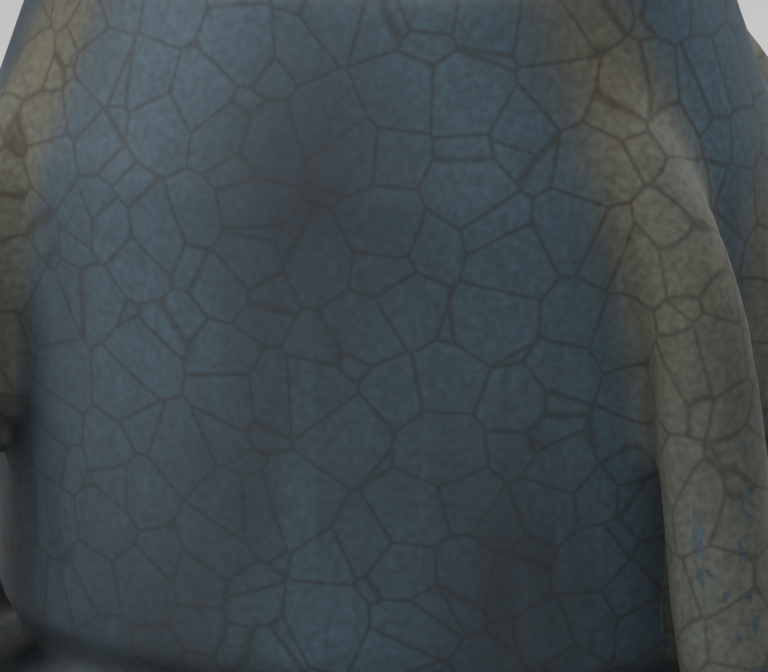](images/begotten-surface-pilots/begotten-dry-storage/closeup.png) | begotten-dry-storage / closeup | REJECTED | 768×672 |
| [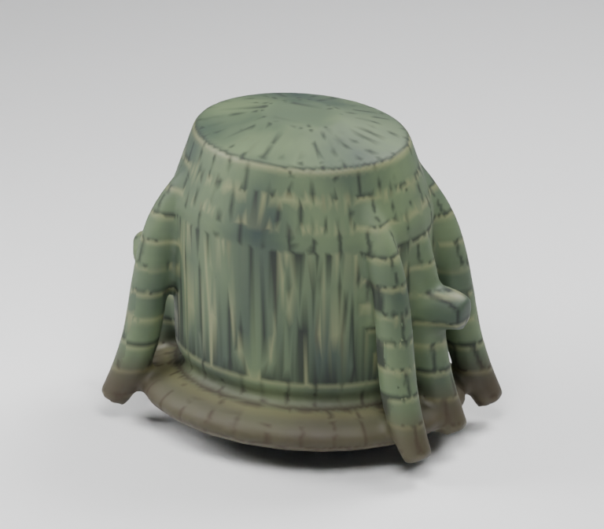](images/begotten-surface-pilots/begotten-dry-storage/front.png) | begotten-dry-storage / front | REJECTED | 768×672 |
| [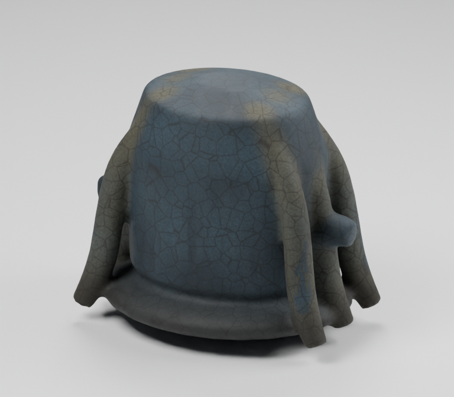](images/begotten-surface-pilots/begotten-dry-storage/rear.png) | begotten-dry-storage / rear | REJECTED | 768×672 |
| [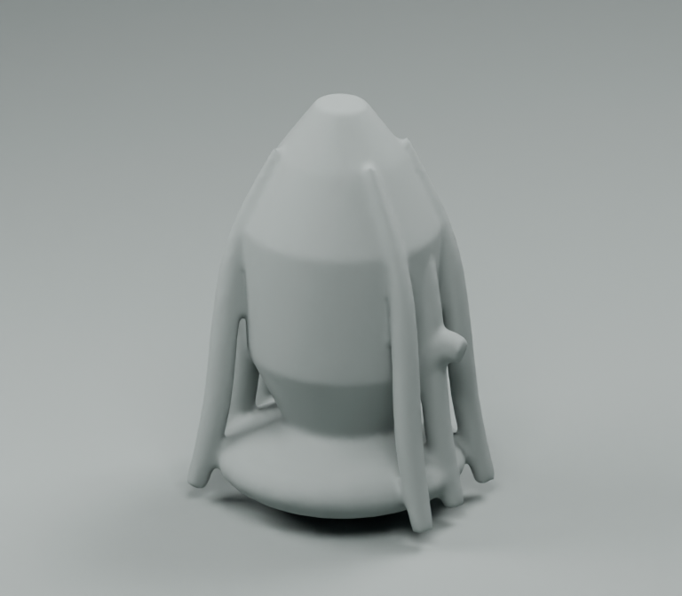](images/begotten-surface-pilots/begotten-fluid-tank/clay.png) | begotten-fluid-tank / clay | REJECTED | 768×672 |
| [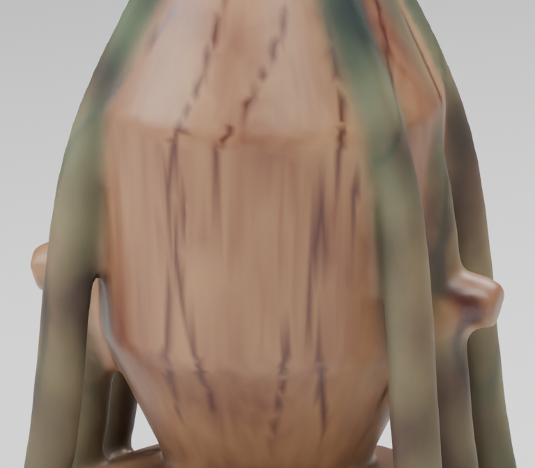](images/begotten-surface-pilots/begotten-fluid-tank/closeup.png) | begotten-fluid-tank / closeup | REJECTED | 768×672 |
| [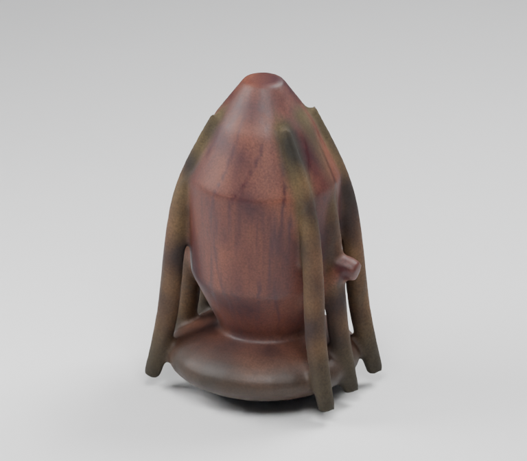](images/begotten-surface-pilots/begotten-fluid-tank/front.png) | begotten-fluid-tank / front | REJECTED | 768×672 |
| [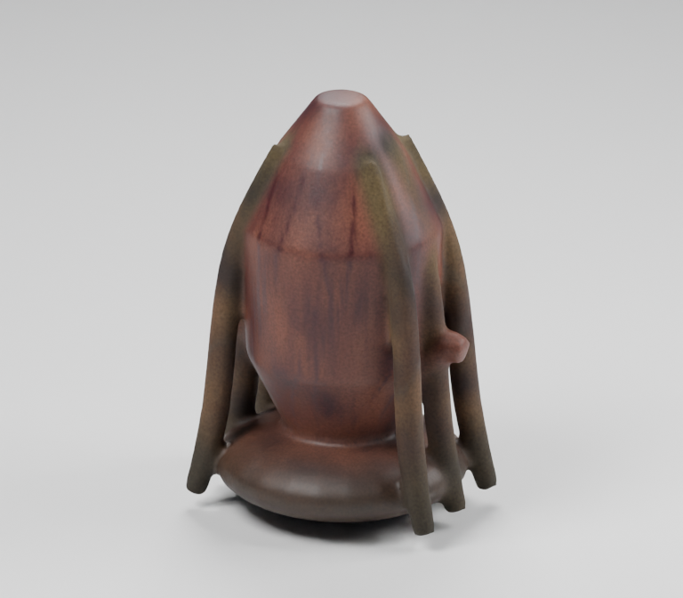](images/begotten-surface-pilots/begotten-fluid-tank/rear.png) | begotten-fluid-tank / rear | REJECTED | 768×672 |
| [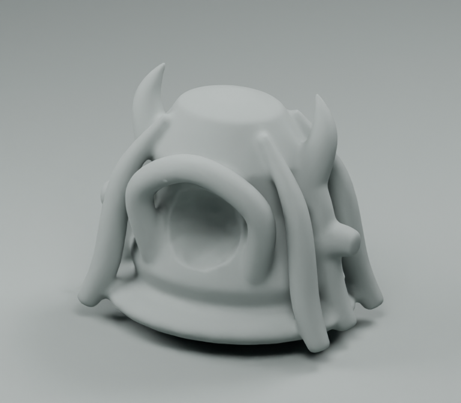](images/begotten-surface-pilots/begotten-processor/clay.png) | begotten-processor / clay | REJECTED | 768×672 |
| [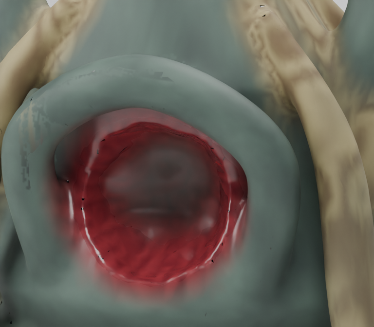](images/begotten-surface-pilots/begotten-processor/closeup.png) | begotten-processor / closeup | REJECTED | 768×672 |
| [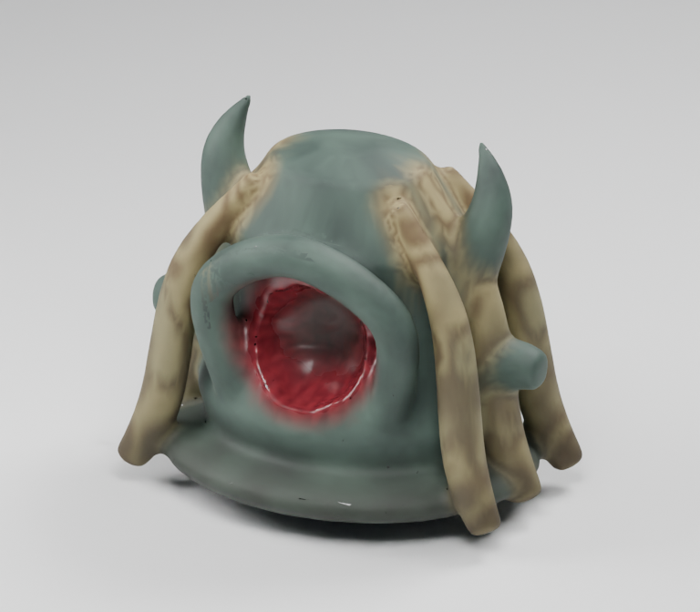](images/begotten-surface-pilots/begotten-processor/front.png) | begotten-processor / front | REJECTED | 768×672 |
| [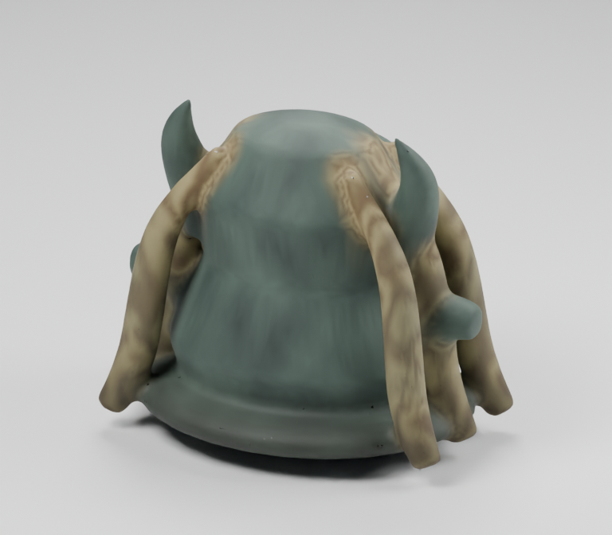](images/begotten-surface-pilots/begotten-processor/rear.png) | begotten-processor / rear | REJECTED | 768×672 |
| [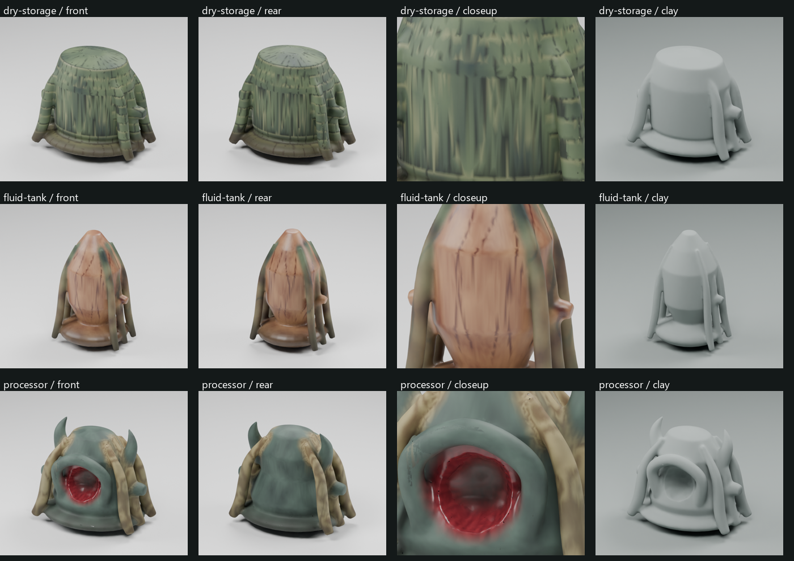](images/begotten-surface-pilots/review.png) | begotten-surface-pilots / review | OVERVIEW_OR_HISTORICAL_STUDY | 1400×990 |
