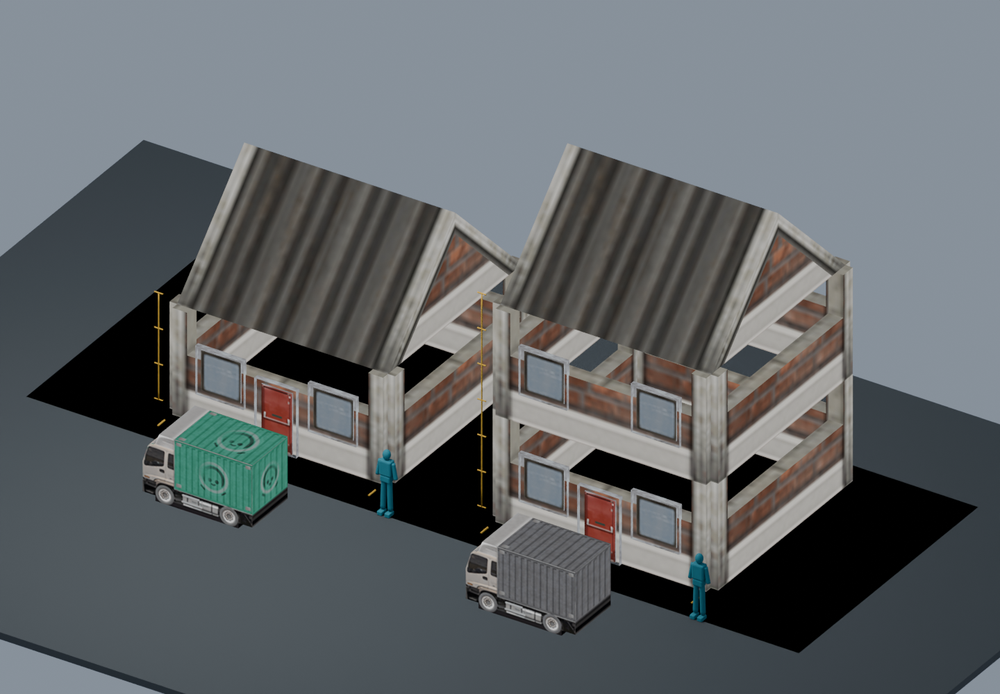
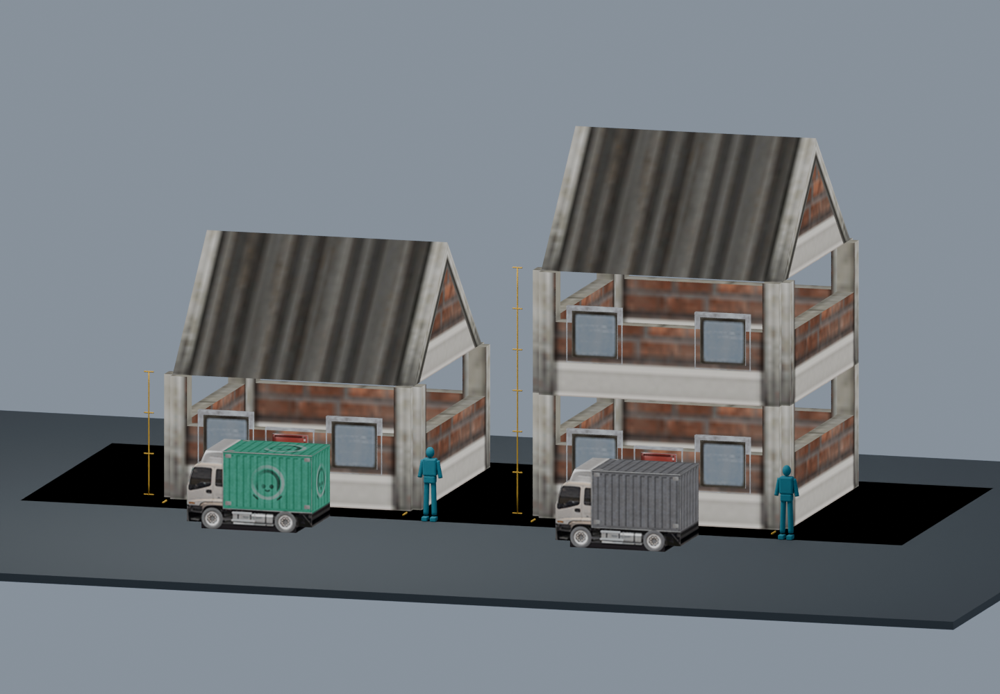

# Kenney city buildings versus vehicles — scale studies

[Back to gallery](README.md)

Measured source-asset scale studies, not runtime screenshots or approved interior replacements. Both examples use a 6 x 6 m footprint and 3 m storeys. Left: one storey; right: two storeys. The original pitched roof adds another 3 m, making the total heights 6 m and 9 m. Vehicles use the actual runtime uniform scale of 1.9: approximately 3.12 m long, 1.58 m wide and 1.91 m high. Blue human measurement guides are 1.8 m tall. Gold ruler ticks are one metre apart.

| Image | Asset / view | Review status | Pixels |
|---|---|---|---|
|  | city-scale-studies / elevated-scale | OVERVIEW_OR_HISTORICAL_STUDY | 1440×1000 |
|  | city-scale-studies / street-scale | OVERVIEW_OR_HISTORICAL_STUDY | 1440×1000 |
