# Thrown field equipment: candidate studies

[Back to gallery](README.md)

| Image | Asset / view | Review status | Pixels |
|---|---|---|---|
|  | field-deployables / clay-roster | OVERVIEW_OR_HISTORICAL_STUDY | 1568×750 |
| [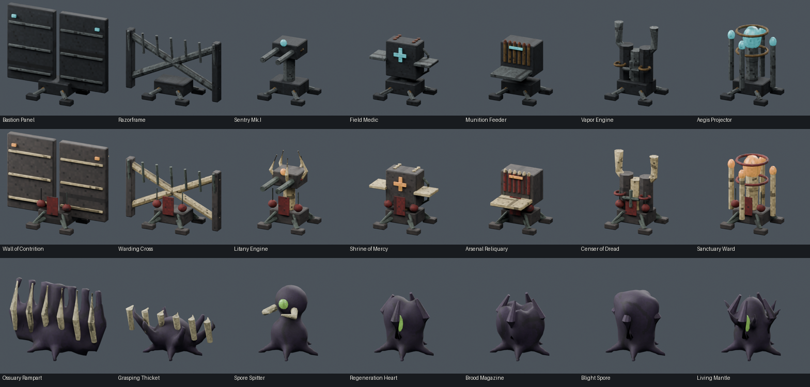](images/field-deployables/closeup-roster.png) | field-deployables / closeup-roster | OVERVIEW_OR_HISTORICAL_STUDY | 1568×750 |
|  | field-deployables / front-roster | OVERVIEW_OR_HISTORICAL_STUDY | 1568×750 |
| [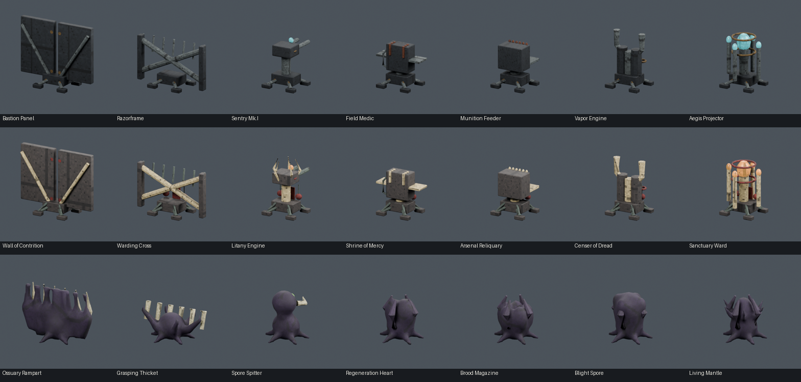](images/field-deployables/rear-roster.png) | field-deployables / rear-roster | OVERVIEW_OR_HISTORICAL_STUDY | 1568×750 |
| [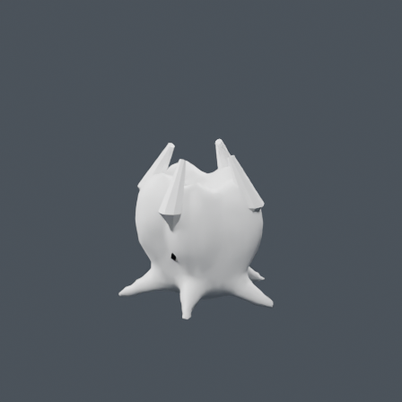](images/field-deployables/thrown-begotten-ammo/clay.png) | thrown-begotten-ammo / clay | REJECTED | 448×448 |
| [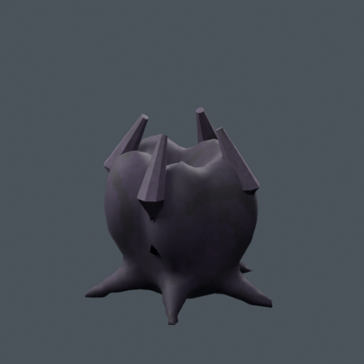](images/field-deployables/thrown-begotten-ammo/closeup.png) | thrown-begotten-ammo / closeup | REJECTED | 448×448 |
|  | thrown-begotten-ammo / front | REJECTED | 448×448 |
| [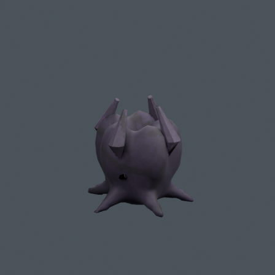](images/field-deployables/thrown-begotten-ammo/rear.png) | thrown-begotten-ammo / rear | REJECTED | 448×448 |
| [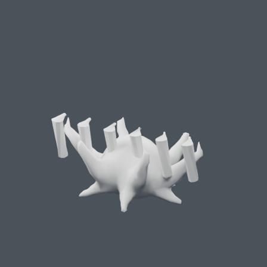](images/field-deployables/thrown-begotten-barricade/clay.png) | thrown-begotten-barricade / clay | REJECTED | 448×448 |
| [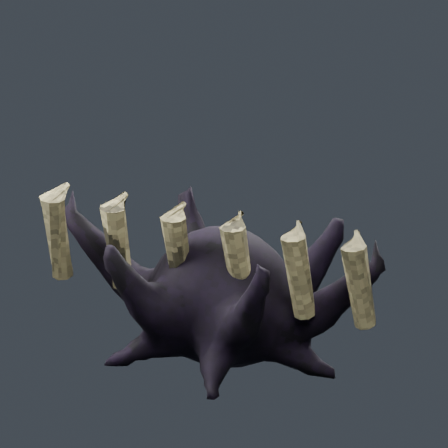](images/field-deployables/thrown-begotten-barricade/closeup.png) | thrown-begotten-barricade / closeup | REJECTED | 448×448 |
| [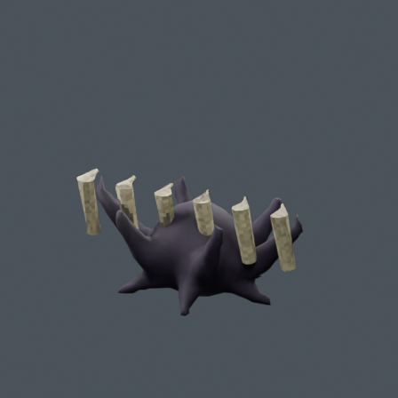](images/field-deployables/thrown-begotten-barricade/front.png) | thrown-begotten-barricade / front | REJECTED | 448×448 |
| [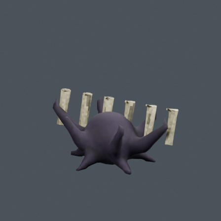](images/field-deployables/thrown-begotten-barricade/rear.png) | thrown-begotten-barricade / rear | REJECTED | 448×448 |
| [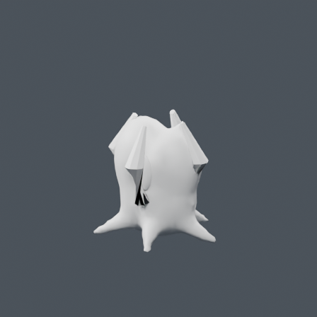](images/field-deployables/thrown-begotten-health/clay.png) | thrown-begotten-health / clay | REJECTED | 448×448 |
| [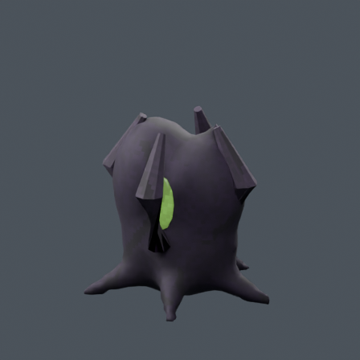](images/field-deployables/thrown-begotten-health/closeup.png) | thrown-begotten-health / closeup | REJECTED | 448×448 |
|  | thrown-begotten-health / front | REJECTED | 448×448 |
| [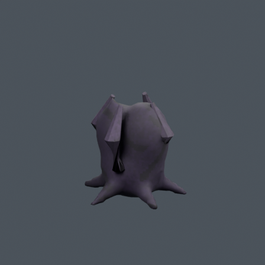](images/field-deployables/thrown-begotten-health/rear.png) | thrown-begotten-health / rear | REJECTED | 448×448 |
| [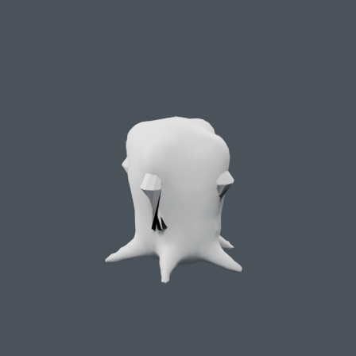](images/field-deployables/thrown-begotten-miasma/clay.png) | thrown-begotten-miasma / clay | REJECTED | 448×448 |
| [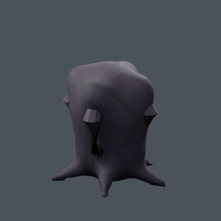](images/field-deployables/thrown-begotten-miasma/closeup.png) | thrown-begotten-miasma / closeup | REJECTED | 448×448 |
| [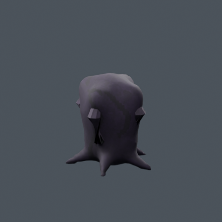](images/field-deployables/thrown-begotten-miasma/front.png) | thrown-begotten-miasma / front | REJECTED | 448×448 |
| [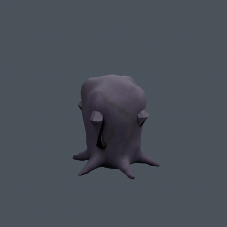](images/field-deployables/thrown-begotten-miasma/rear.png) | thrown-begotten-miasma / rear | REJECTED | 448×448 |
| [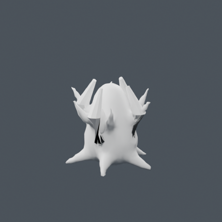](images/field-deployables/thrown-begotten-shield/clay.png) | thrown-begotten-shield / clay | REJECTED | 448×448 |
|  | thrown-begotten-shield / closeup | REJECTED | 448×448 |
| [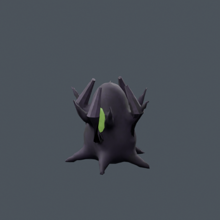](images/field-deployables/thrown-begotten-shield/front.png) | thrown-begotten-shield / front | REJECTED | 448×448 |
| [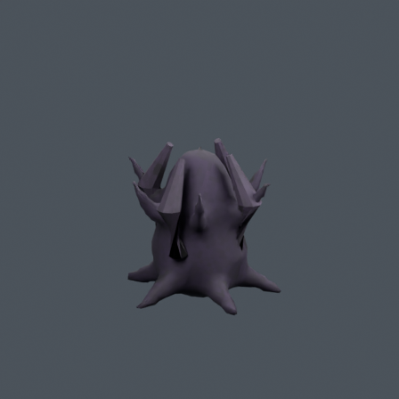](images/field-deployables/thrown-begotten-shield/rear.png) | thrown-begotten-shield / rear | REJECTED | 448×448 |
| [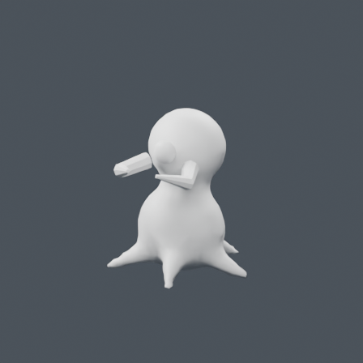](images/field-deployables/thrown-begotten-turret/clay.png) | thrown-begotten-turret / clay | REJECTED | 448×448 |
| [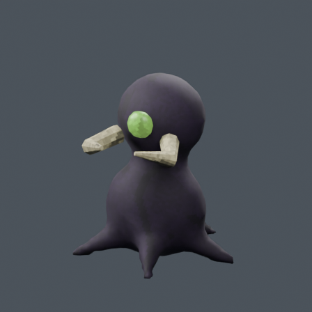](images/field-deployables/thrown-begotten-turret/closeup.png) | thrown-begotten-turret / closeup | REJECTED | 448×448 |
| [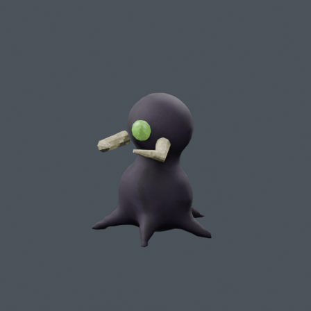](images/field-deployables/thrown-begotten-turret/front.png) | thrown-begotten-turret / front | REJECTED | 448×448 |
| [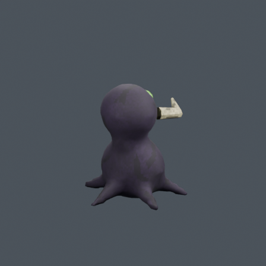](images/field-deployables/thrown-begotten-turret/rear.png) | thrown-begotten-turret / rear | REJECTED | 448×448 |
| [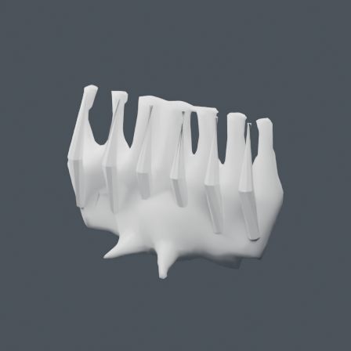](images/field-deployables/thrown-begotten-wall/clay.png) | thrown-begotten-wall / clay | REJECTED | 448×448 |
|  | thrown-begotten-wall / closeup | REJECTED | 448×448 |
| [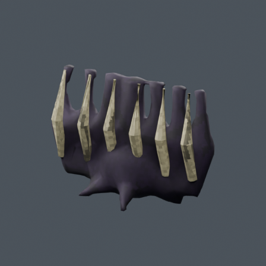](images/field-deployables/thrown-begotten-wall/front.png) | thrown-begotten-wall / front | REJECTED | 448×448 |
| [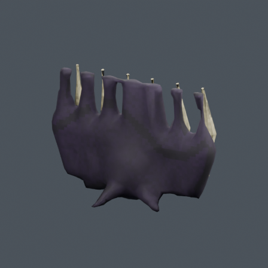](images/field-deployables/thrown-begotten-wall/rear.png) | thrown-begotten-wall / rear | REJECTED | 448×448 |
|  | thrown-penitent-ammo / clay | REJECTED | 448×448 |
| [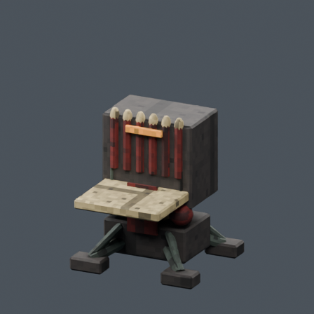](images/field-deployables/thrown-penitent-ammo/closeup.png) | thrown-penitent-ammo / closeup | REJECTED | 448×448 |
| [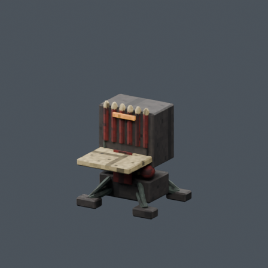](images/field-deployables/thrown-penitent-ammo/front.png) | thrown-penitent-ammo / front | REJECTED | 448×448 |
| [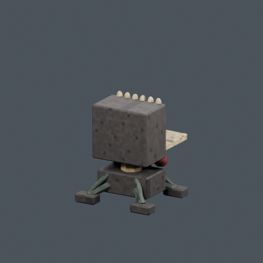](images/field-deployables/thrown-penitent-ammo/rear.png) | thrown-penitent-ammo / rear | REJECTED | 448×448 |
| [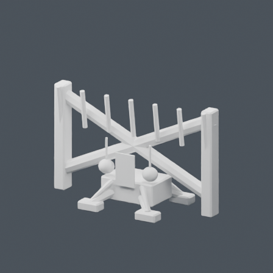](images/field-deployables/thrown-penitent-barricade/clay.png) | thrown-penitent-barricade / clay | REJECTED | 448×448 |
|  | thrown-penitent-barricade / closeup | REJECTED | 448×448 |
| [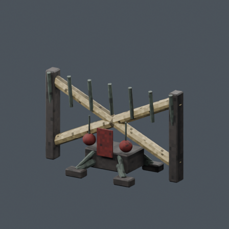](images/field-deployables/thrown-penitent-barricade/front.png) | thrown-penitent-barricade / front | REJECTED | 448×448 |
| [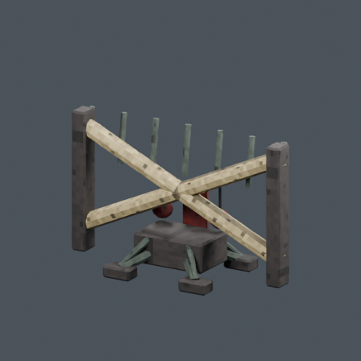](images/field-deployables/thrown-penitent-barricade/rear.png) | thrown-penitent-barricade / rear | REJECTED | 448×448 |
|  | thrown-penitent-health / clay | REJECTED | 448×448 |
| [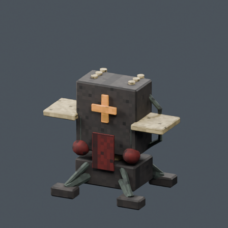](images/field-deployables/thrown-penitent-health/closeup.png) | thrown-penitent-health / closeup | REJECTED | 448×448 |
|  | thrown-penitent-health / front | REJECTED | 448×448 |
| [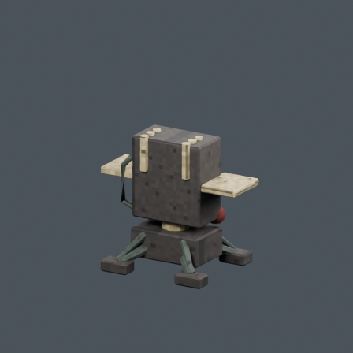](images/field-deployables/thrown-penitent-health/rear.png) | thrown-penitent-health / rear | REJECTED | 448×448 |
|  | thrown-penitent-miasma / clay | REJECTED | 448×448 |
| [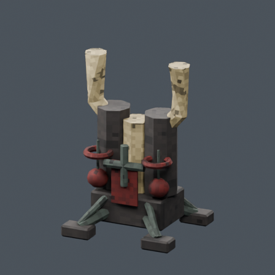](images/field-deployables/thrown-penitent-miasma/closeup.png) | thrown-penitent-miasma / closeup | REJECTED | 448×448 |
| [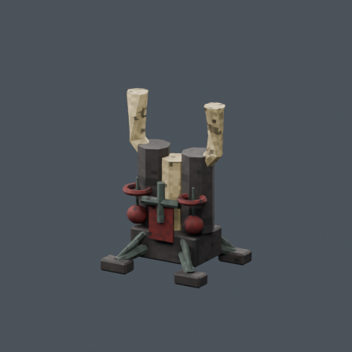](images/field-deployables/thrown-penitent-miasma/front.png) | thrown-penitent-miasma / front | REJECTED | 448×448 |
| [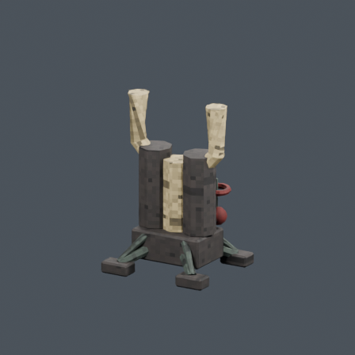](images/field-deployables/thrown-penitent-miasma/rear.png) | thrown-penitent-miasma / rear | REJECTED | 448×448 |
| [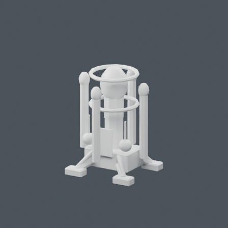](images/field-deployables/thrown-penitent-shield/clay.png) | thrown-penitent-shield / clay | REJECTED | 448×448 |
| [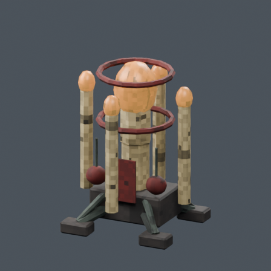](images/field-deployables/thrown-penitent-shield/closeup.png) | thrown-penitent-shield / closeup | REJECTED | 448×448 |
|  | thrown-penitent-shield / front | REJECTED | 448×448 |
| [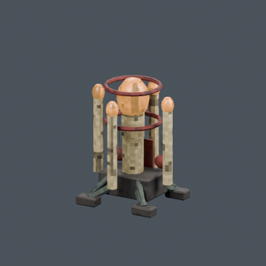](images/field-deployables/thrown-penitent-shield/rear.png) | thrown-penitent-shield / rear | REJECTED | 448×448 |
| [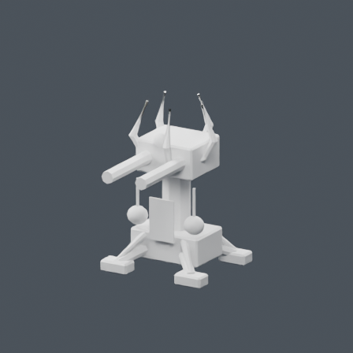](images/field-deployables/thrown-penitent-turret/clay.png) | thrown-penitent-turret / clay | REJECTED | 448×448 |
|  | thrown-penitent-turret / closeup | REJECTED | 448×448 |
|  | thrown-penitent-turret / front | REJECTED | 448×448 |
| [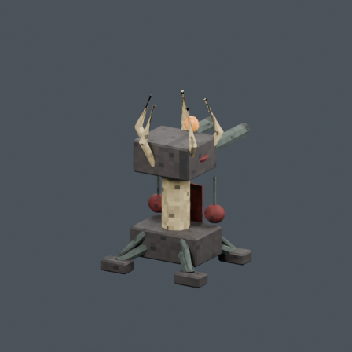](images/field-deployables/thrown-penitent-turret/rear.png) | thrown-penitent-turret / rear | REJECTED | 448×448 |
| [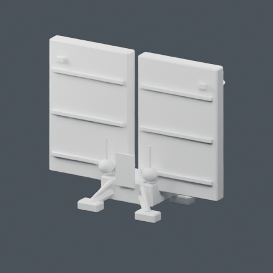](images/field-deployables/thrown-penitent-wall/clay.png) | thrown-penitent-wall / clay | REJECTED | 448×448 |
|  | thrown-penitent-wall / closeup | REJECTED | 448×448 |
|  | thrown-penitent-wall / front | REJECTED | 448×448 |
| [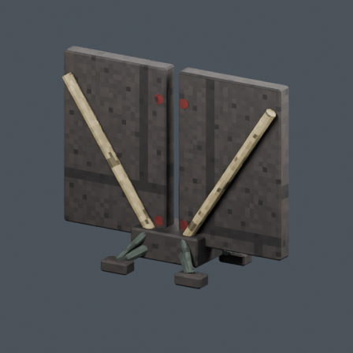](images/field-deployables/thrown-penitent-wall/rear.png) | thrown-penitent-wall / rear | REJECTED | 448×448 |
|  | thrown-unraveled-ammo / clay | REJECTED | 448×448 |
|  | thrown-unraveled-ammo / closeup | REJECTED | 448×448 |
|  | thrown-unraveled-ammo / front | REJECTED | 448×448 |
|  | thrown-unraveled-ammo / rear | REJECTED | 448×448 |
|  | thrown-unraveled-barricade / clay | REJECTED | 448×448 |
|  | thrown-unraveled-barricade / closeup | REJECTED | 448×448 |
| [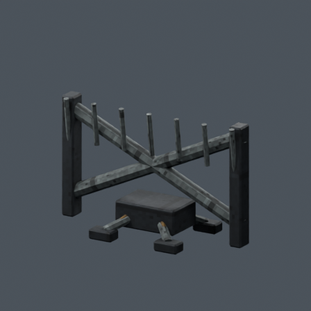](images/field-deployables/thrown-unraveled-barricade/front.png) | thrown-unraveled-barricade / front | REJECTED | 448×448 |
| [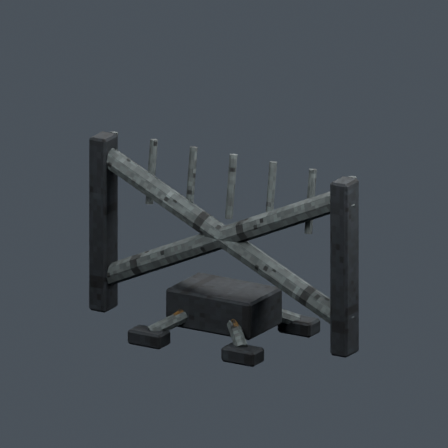](images/field-deployables/thrown-unraveled-barricade/rear.png) | thrown-unraveled-barricade / rear | REJECTED | 448×448 |
| [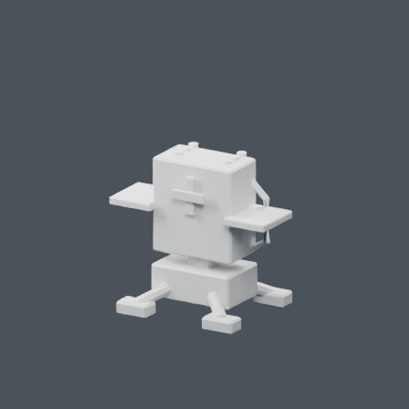](images/field-deployables/thrown-unraveled-health/clay.png) | thrown-unraveled-health / clay | REJECTED | 448×448 |
| [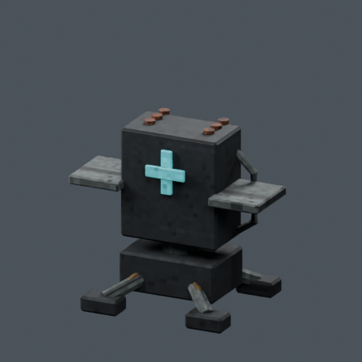](images/field-deployables/thrown-unraveled-health/closeup.png) | thrown-unraveled-health / closeup | REJECTED | 448×448 |
| [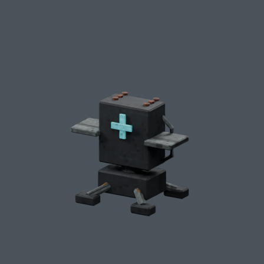](images/field-deployables/thrown-unraveled-health/front.png) | thrown-unraveled-health / front | REJECTED | 448×448 |
| [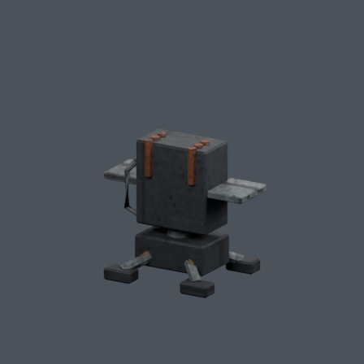](images/field-deployables/thrown-unraveled-health/rear.png) | thrown-unraveled-health / rear | REJECTED | 448×448 |
|  | thrown-unraveled-miasma / clay | REJECTED | 448×448 |
|  | thrown-unraveled-miasma / closeup | REJECTED | 448×448 |
|  | thrown-unraveled-miasma / front | REJECTED | 448×448 |
|  | thrown-unraveled-miasma / rear | REJECTED | 448×448 |
|  | thrown-unraveled-shield / clay | REJECTED | 448×448 |
|  | thrown-unraveled-shield / closeup | REJECTED | 448×448 |
|  | thrown-unraveled-shield / front | REJECTED | 448×448 |
|  | thrown-unraveled-shield / rear | REJECTED | 448×448 |
|  | thrown-unraveled-turret / clay | REJECTED | 448×448 |
|  | thrown-unraveled-turret / closeup | REJECTED | 448×448 |
|  | thrown-unraveled-turret / front | REJECTED | 448×448 |
|  | thrown-unraveled-turret / rear | REJECTED | 448×448 |
|  | thrown-unraveled-wall / clay | REJECTED | 448×448 |
|  | thrown-unraveled-wall / closeup | REJECTED | 448×448 |
|  | thrown-unraveled-wall / front | REJECTED | 448×448 |
|  | thrown-unraveled-wall / rear | REJECTED | 448×448 |
