# Field Medic repair study

[Back to gallery](README.md)

| Image | Asset / view | Review status | Pixels |
|---|---|---|---|
| [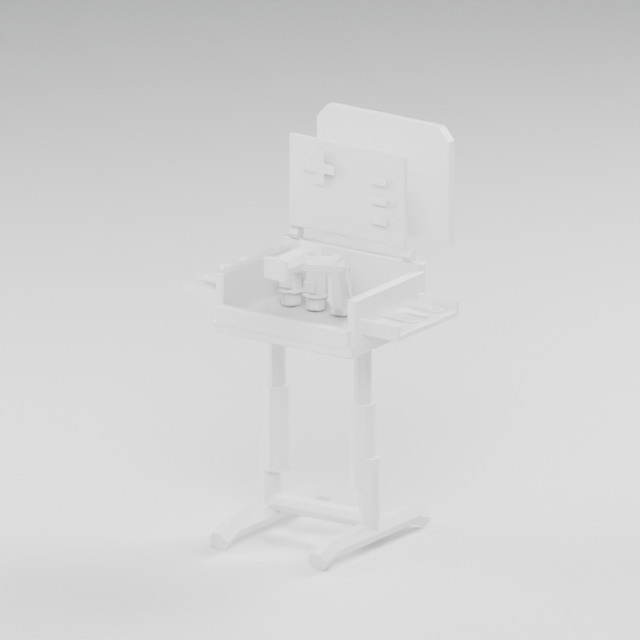](images/field-medic-r1/field-medic/clay.png) | field-medic / clay | REJECTED | 640×640 |
| [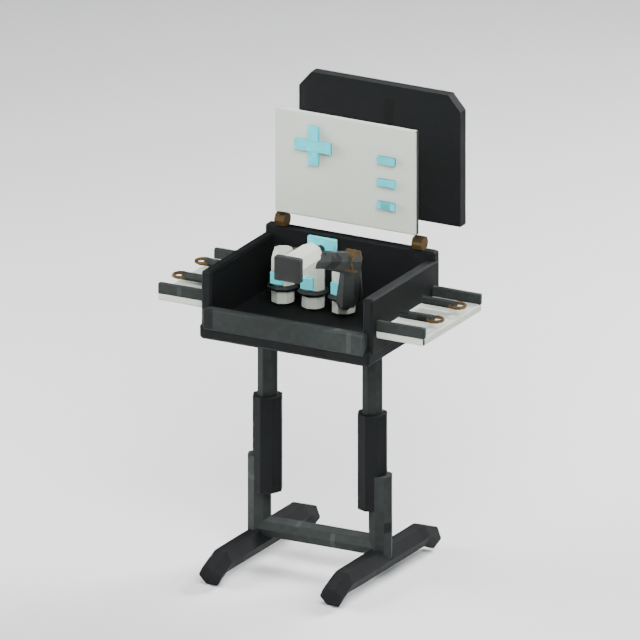](images/field-medic-r1/field-medic/closeup.png) | field-medic / closeup | REJECTED | 640×640 |
| [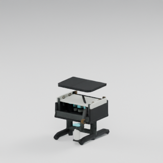](images/field-medic-r1/field-medic/deploying-00.png) | field-medic / deploying-00 | REJECTED | 320×320 |
| [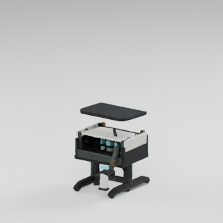](images/field-medic-r1/field-medic/deploying-01.png) | field-medic / deploying-01 | REJECTED | 320×320 |
| [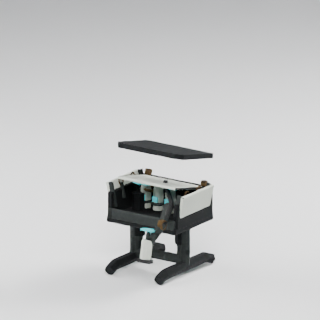](images/field-medic-r1/field-medic/deploying-02.png) | field-medic / deploying-02 | REJECTED | 320×320 |
| [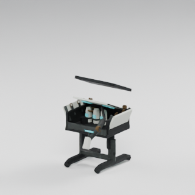](images/field-medic-r1/field-medic/deploying-03.png) | field-medic / deploying-03 | REJECTED | 320×320 |
| [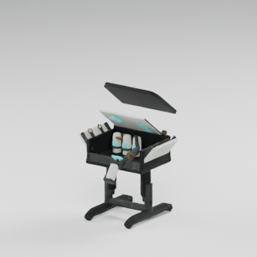](images/field-medic-r1/field-medic/deploying-04.png) | field-medic / deploying-04 | REJECTED | 320×320 |
| [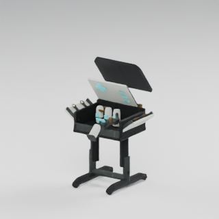](images/field-medic-r1/field-medic/deploying-05.png) | field-medic / deploying-05 | REJECTED | 320×320 |
|  | field-medic / deploying-06 | REJECTED | 320×320 |
| [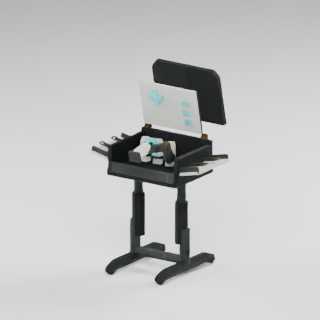](images/field-medic-r1/field-medic/deploying-07.png) | field-medic / deploying-07 | REJECTED | 320×320 |
| [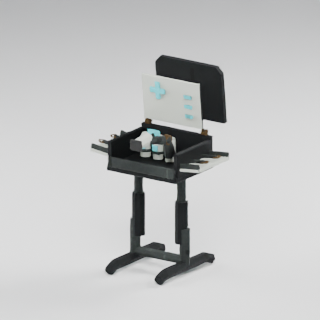](images/field-medic-r1/field-medic/deploying-08.png) | field-medic / deploying-08 | REJECTED | 320×320 |
|  | field-medic / deploying-09 | REJECTED | 320×320 |
| [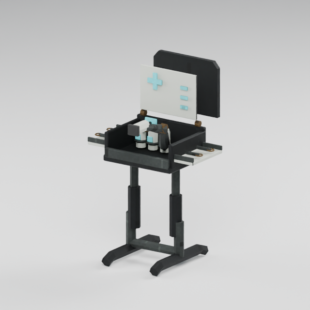](images/field-medic-r1/field-medic/front.png) | field-medic / front | REJECTED | 640×640 |
|  | field-medic / operating-00 | REJECTED | 320×320 |
|  | field-medic / operating-01 | REJECTED | 320×320 |
|  | field-medic / operating-02 | REJECTED | 320×320 |
| [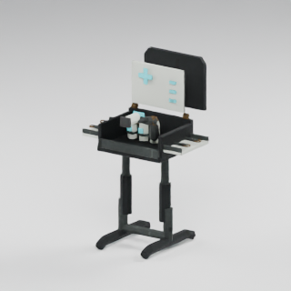](images/field-medic-r1/field-medic/operating-03.png) | field-medic / operating-03 | REJECTED | 320×320 |
| [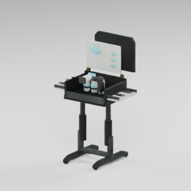](images/field-medic-r1/field-medic/operating-04.png) | field-medic / operating-04 | REJECTED | 320×320 |
|  | field-medic / operating-05 | REJECTED | 320×320 |
|  | field-medic / operating-06 | REJECTED | 320×320 |
|  | field-medic / operating-07 | REJECTED | 320×320 |
|  | field-medic / operating-08 | REJECTED | 320×320 |
|  | field-medic / operating-09 | REJECTED | 320×320 |
|  | field-medic / packed-00 | REJECTED | 320×320 |
| [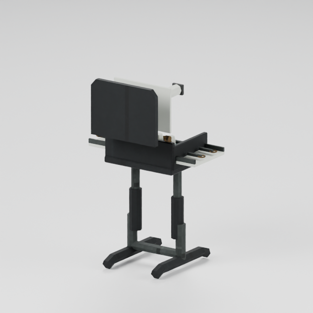](images/field-medic-r1/field-medic/rear.png) | field-medic / rear | REJECTED | 640×640 |
