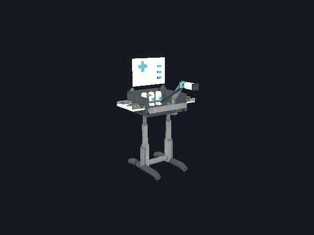
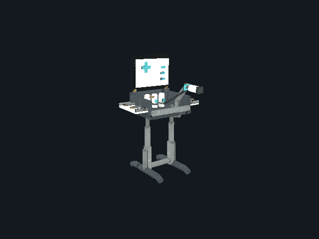
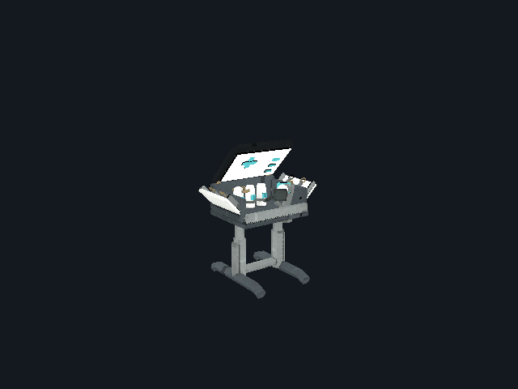
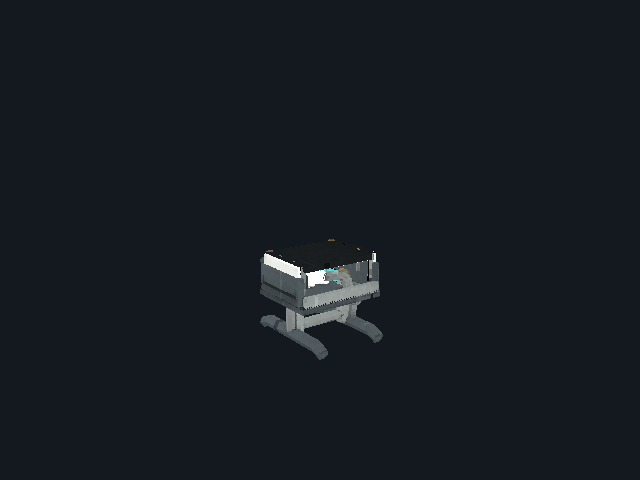
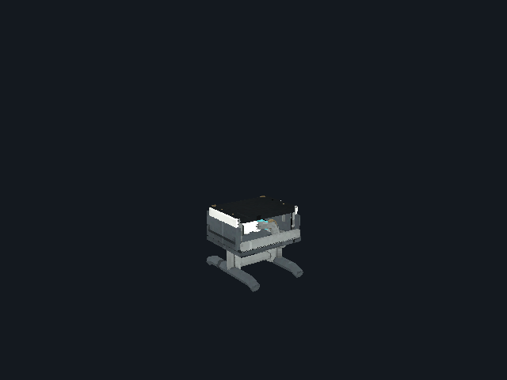
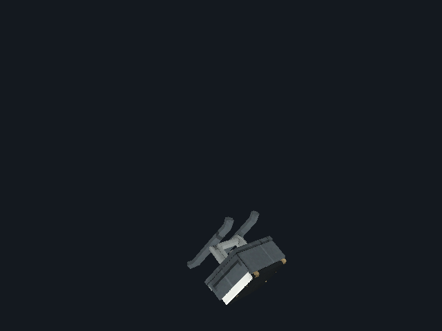

# Field Medic R7 — review required

[Back to gallery](README.md)

| Image | Asset / view | Review status | Pixels |
|---|---|---|---|
|  | gpu / active | OVERVIEW_OR_HISTORICAL_STUDY | 640×480 |
|  | gpu / damaged | OVERVIEW_OR_HISTORICAL_STUDY | 640×480 |
|  | gpu / deploying | OVERVIEW_OR_HISTORICAL_STUDY | 640×480 |
|  | gpu / destroyed | OVERVIEW_OR_HISTORICAL_STUDY | 640×480 |
|  | gpu / expiring | OVERVIEW_OR_HISTORICAL_STUDY | 640×480 |
|  | gpu / impact | OVERVIEW_OR_HISTORICAL_STUDY | 640×480 |
|  | gpu / operating | OVERVIEW_OR_HISTORICAL_STUDY | 640×480 |
|  | gpu / packed | OVERVIEW_OR_HISTORICAL_STUDY | 640×480 |
|  | gpu / thrown | OVERVIEW_OR_HISTORICAL_STUDY | 640×480 |
