# Deployable pilot studies r2

[Back to gallery](README.md)

| Image | Asset / view | Review status | Pixels |
|---|---|---|---|
| [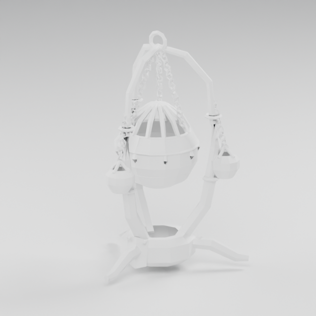](images/field-pilots-r2/censer-of-dread/clay.png) | censer-of-dread / clay | REJECTED | 640×640 |
| [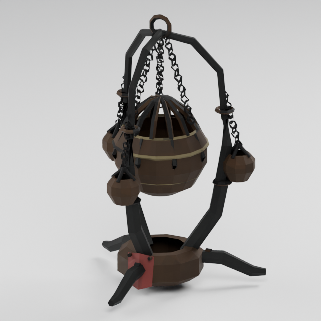](images/field-pilots-r2/censer-of-dread/closeup.png) | censer-of-dread / closeup | REJECTED | 640×640 |
| [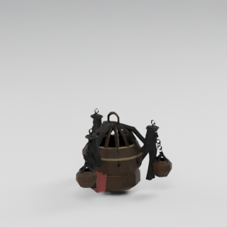](images/field-pilots-r2/censer-of-dread/deploying-00.png) | censer-of-dread / deploying-00 | REJECTED | 320×320 |
| [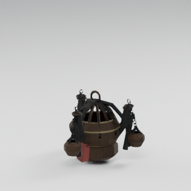](images/field-pilots-r2/censer-of-dread/deploying-01.png) | censer-of-dread / deploying-01 | REJECTED | 320×320 |
| [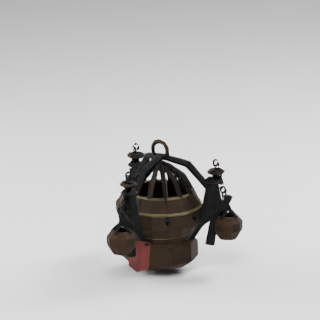](images/field-pilots-r2/censer-of-dread/deploying-02.png) | censer-of-dread / deploying-02 | REJECTED | 320×320 |
| [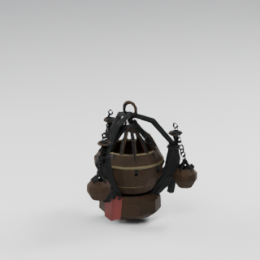](images/field-pilots-r2/censer-of-dread/deploying-03.png) | censer-of-dread / deploying-03 | REJECTED | 320×320 |
| [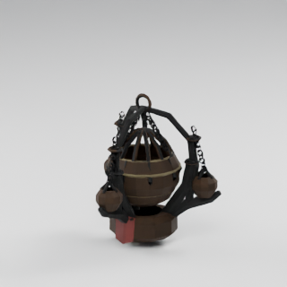](images/field-pilots-r2/censer-of-dread/deploying-04.png) | censer-of-dread / deploying-04 | REJECTED | 320×320 |
| [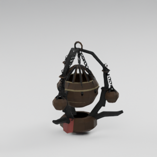](images/field-pilots-r2/censer-of-dread/deploying-05.png) | censer-of-dread / deploying-05 | REJECTED | 320×320 |
| [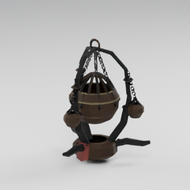](images/field-pilots-r2/censer-of-dread/deploying-06.png) | censer-of-dread / deploying-06 | REJECTED | 320×320 |
| [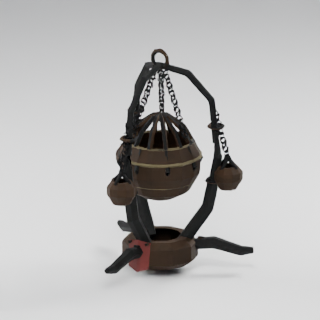](images/field-pilots-r2/censer-of-dread/deploying-07.png) | censer-of-dread / deploying-07 | REJECTED | 320×320 |
| [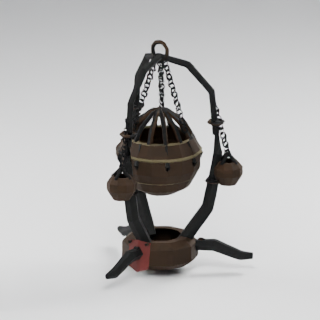](images/field-pilots-r2/censer-of-dread/deploying-08.png) | censer-of-dread / deploying-08 | REJECTED | 320×320 |
| [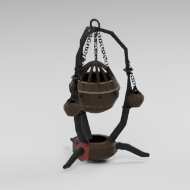](images/field-pilots-r2/censer-of-dread/deploying-09.png) | censer-of-dread / deploying-09 | REJECTED | 320×320 |
| [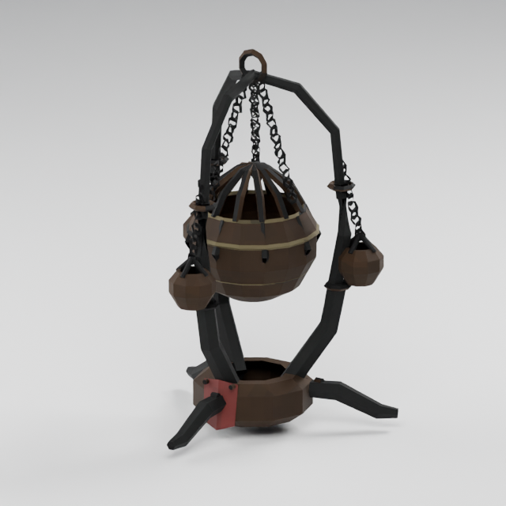](images/field-pilots-r2/censer-of-dread/front.png) | censer-of-dread / front | REJECTED | 640×640 |
|  | censer-of-dread / operating-00 | REJECTED | 320×320 |
| [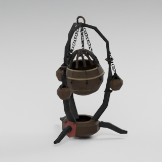](images/field-pilots-r2/censer-of-dread/operating-01.png) | censer-of-dread / operating-01 | REJECTED | 320×320 |
| [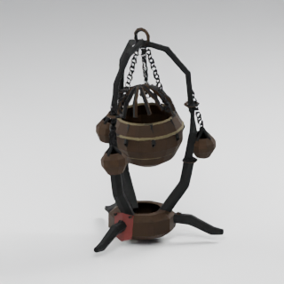](images/field-pilots-r2/censer-of-dread/operating-02.png) | censer-of-dread / operating-02 | REJECTED | 320×320 |
|  | censer-of-dread / operating-03 | REJECTED | 320×320 |
| [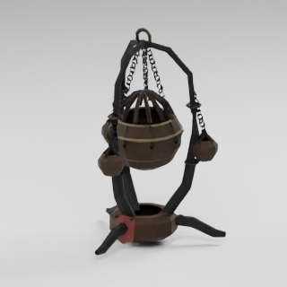](images/field-pilots-r2/censer-of-dread/operating-04.png) | censer-of-dread / operating-04 | REJECTED | 320×320 |
| [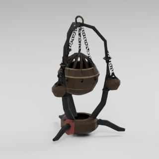](images/field-pilots-r2/censer-of-dread/operating-05.png) | censer-of-dread / operating-05 | REJECTED | 320×320 |
| [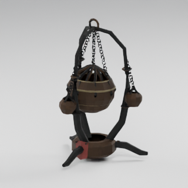](images/field-pilots-r2/censer-of-dread/operating-06.png) | censer-of-dread / operating-06 | REJECTED | 320×320 |
| [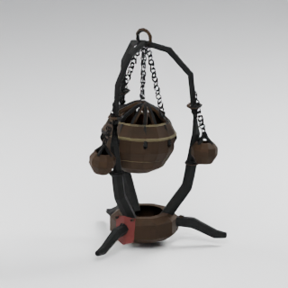](images/field-pilots-r2/censer-of-dread/operating-07.png) | censer-of-dread / operating-07 | REJECTED | 320×320 |
| [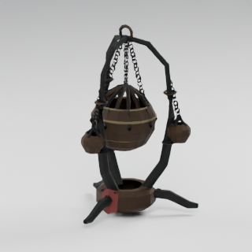](images/field-pilots-r2/censer-of-dread/operating-08.png) | censer-of-dread / operating-08 | REJECTED | 320×320 |
|  | censer-of-dread / operating-09 | REJECTED | 320×320 |
|  | censer-of-dread / packed-00 | REJECTED | 320×320 |
| [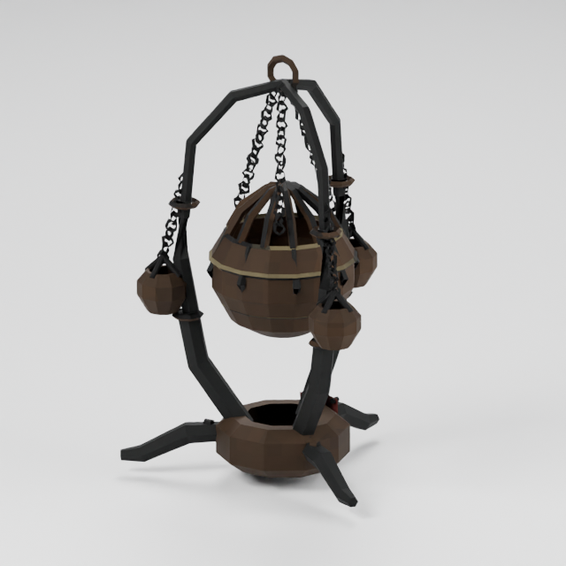](images/field-pilots-r2/censer-of-dread/rear.png) | censer-of-dread / rear | REJECTED | 640×640 |
| [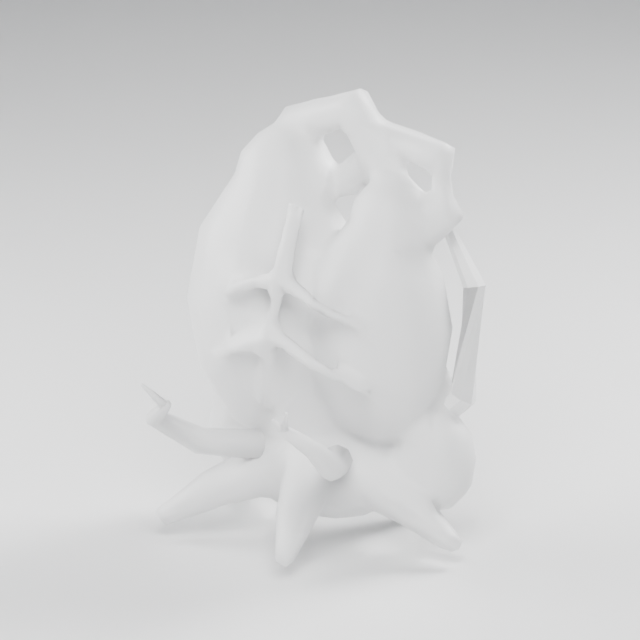](images/field-pilots-r2/regeneration-heart/clay.png) | regeneration-heart / clay | REJECTED | 640×640 |
| [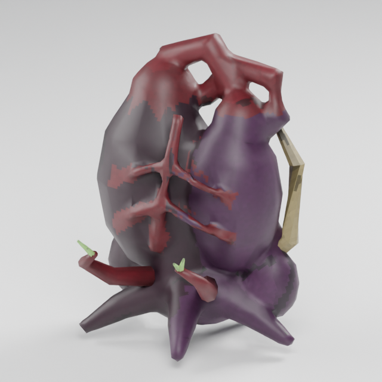](images/field-pilots-r2/regeneration-heart/closeup.png) | regeneration-heart / closeup | REJECTED | 640×640 |
| [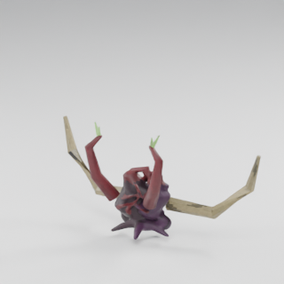](images/field-pilots-r2/regeneration-heart/deploying-00.png) | regeneration-heart / deploying-00 | REJECTED | 320×320 |
| [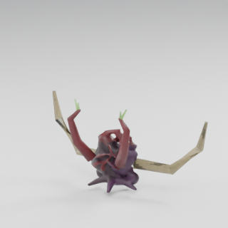](images/field-pilots-r2/regeneration-heart/deploying-01.png) | regeneration-heart / deploying-01 | REJECTED | 320×320 |
| [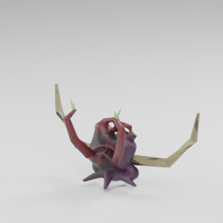](images/field-pilots-r2/regeneration-heart/deploying-02.png) | regeneration-heart / deploying-02 | REJECTED | 320×320 |
| [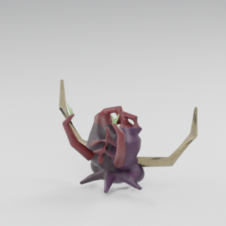](images/field-pilots-r2/regeneration-heart/deploying-03.png) | regeneration-heart / deploying-03 | REJECTED | 320×320 |
| [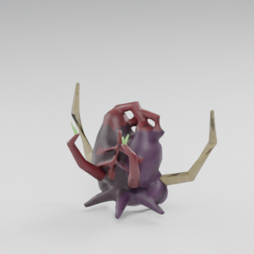](images/field-pilots-r2/regeneration-heart/deploying-04.png) | regeneration-heart / deploying-04 | REJECTED | 320×320 |
| [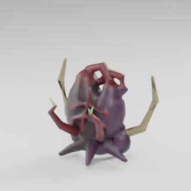](images/field-pilots-r2/regeneration-heart/deploying-05.png) | regeneration-heart / deploying-05 | REJECTED | 320×320 |
| [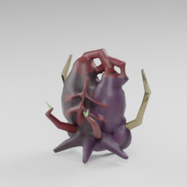](images/field-pilots-r2/regeneration-heart/deploying-06.png) | regeneration-heart / deploying-06 | REJECTED | 320×320 |
| [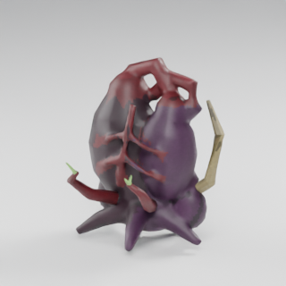](images/field-pilots-r2/regeneration-heart/deploying-07.png) | regeneration-heart / deploying-07 | REJECTED | 320×320 |
| [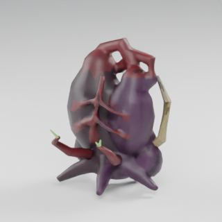](images/field-pilots-r2/regeneration-heart/deploying-08.png) | regeneration-heart / deploying-08 | REJECTED | 320×320 |
| [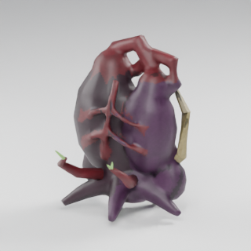](images/field-pilots-r2/regeneration-heart/deploying-09.png) | regeneration-heart / deploying-09 | REJECTED | 320×320 |
|  | regeneration-heart / front | REJECTED | 640×640 |
|  | regeneration-heart / operating-00 | REJECTED | 320×320 |
| [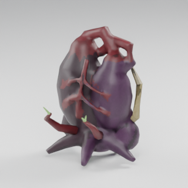](images/field-pilots-r2/regeneration-heart/operating-01.png) | regeneration-heart / operating-01 | REJECTED | 320×320 |
|  | regeneration-heart / operating-02 | REJECTED | 320×320 |
|  | regeneration-heart / operating-03 | REJECTED | 320×320 |
| [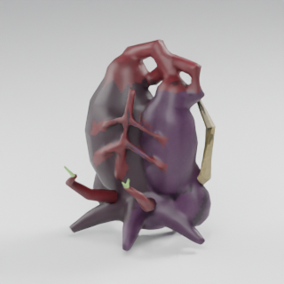](images/field-pilots-r2/regeneration-heart/operating-04.png) | regeneration-heart / operating-04 | REJECTED | 320×320 |
| [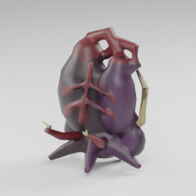](images/field-pilots-r2/regeneration-heart/operating-05.png) | regeneration-heart / operating-05 | REJECTED | 320×320 |
|  | regeneration-heart / operating-06 | REJECTED | 320×320 |
|  | regeneration-heart / operating-07 | REJECTED | 320×320 |
| [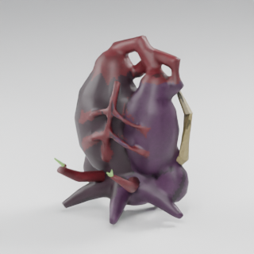](images/field-pilots-r2/regeneration-heart/operating-08.png) | regeneration-heart / operating-08 | REJECTED | 320×320 |
|  | regeneration-heart / operating-09 | REJECTED | 320×320 |
|  | regeneration-heart / packed-00 | REJECTED | 320×320 |
| [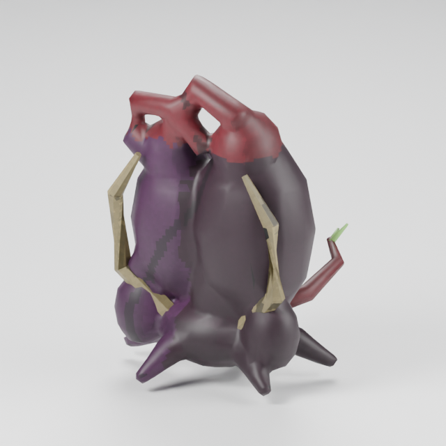](images/field-pilots-r2/regeneration-heart/rear.png) | regeneration-heart / rear | REJECTED | 640×640 |
| [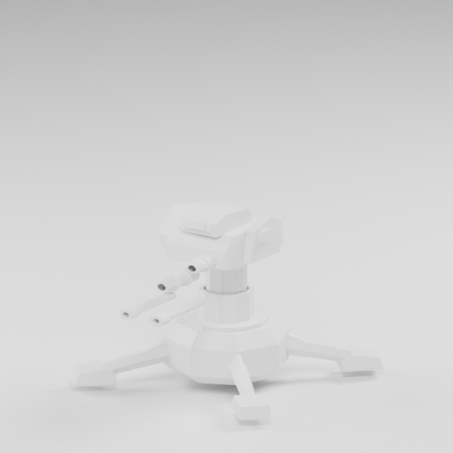](images/field-pilots-r2/sentry-mki/clay.png) | sentry-mki / clay | REJECTED | 640×640 |
| [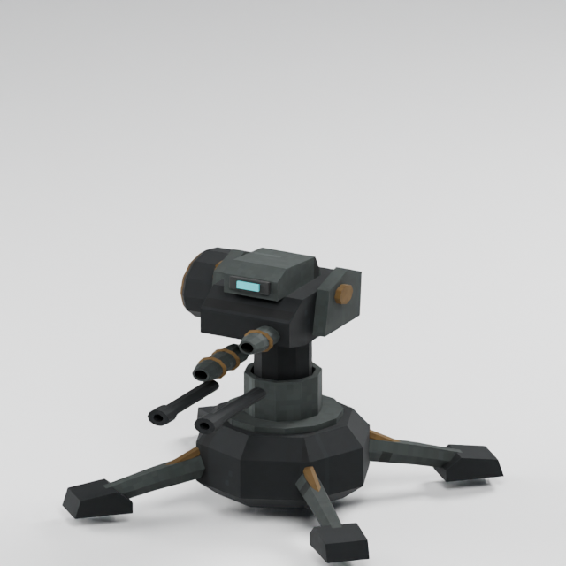](images/field-pilots-r2/sentry-mki/closeup.png) | sentry-mki / closeup | REJECTED | 640×640 |
| [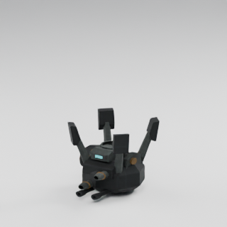](images/field-pilots-r2/sentry-mki/deploying-00.png) | sentry-mki / deploying-00 | REJECTED | 320×320 |
| [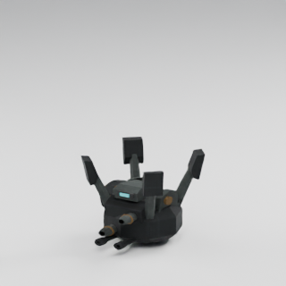](images/field-pilots-r2/sentry-mki/deploying-01.png) | sentry-mki / deploying-01 | REJECTED | 320×320 |
| [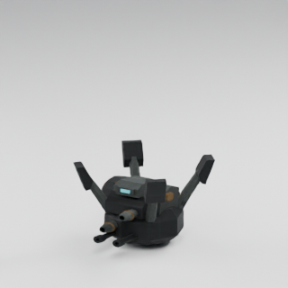](images/field-pilots-r2/sentry-mki/deploying-02.png) | sentry-mki / deploying-02 | REJECTED | 320×320 |
| [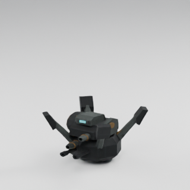](images/field-pilots-r2/sentry-mki/deploying-03.png) | sentry-mki / deploying-03 | REJECTED | 320×320 |
| [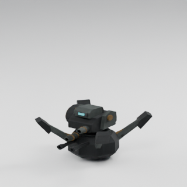](images/field-pilots-r2/sentry-mki/deploying-04.png) | sentry-mki / deploying-04 | REJECTED | 320×320 |
| [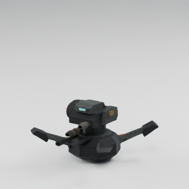](images/field-pilots-r2/sentry-mki/deploying-05.png) | sentry-mki / deploying-05 | REJECTED | 320×320 |
| [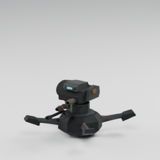](images/field-pilots-r2/sentry-mki/deploying-06.png) | sentry-mki / deploying-06 | REJECTED | 320×320 |
| [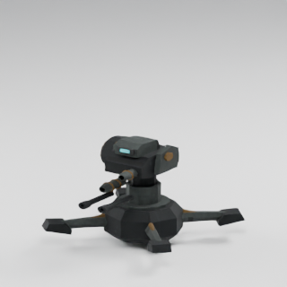](images/field-pilots-r2/sentry-mki/deploying-07.png) | sentry-mki / deploying-07 | REJECTED | 320×320 |
| [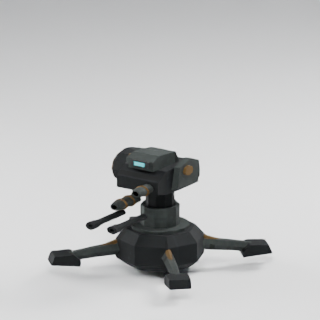](images/field-pilots-r2/sentry-mki/deploying-08.png) | sentry-mki / deploying-08 | REJECTED | 320×320 |
| [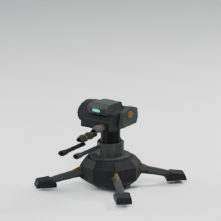](images/field-pilots-r2/sentry-mki/deploying-09.png) | sentry-mki / deploying-09 | REJECTED | 320×320 |
|  | sentry-mki / front | REJECTED | 640×640 |
|  | sentry-mki / operating-00 | REJECTED | 320×320 |
|  | sentry-mki / operating-01 | REJECTED | 320×320 |
|  | sentry-mki / operating-02 | REJECTED | 320×320 |
|  | sentry-mki / operating-03 | REJECTED | 320×320 |
|  | sentry-mki / operating-04 | REJECTED | 320×320 |
|  | sentry-mki / operating-05 | REJECTED | 320×320 |
|  | sentry-mki / operating-06 | REJECTED | 320×320 |
|  | sentry-mki / operating-07 | REJECTED | 320×320 |
|  | sentry-mki / operating-08 | REJECTED | 320×320 |
|  | sentry-mki / operating-09 | REJECTED | 320×320 |
|  | sentry-mki / packed-00 | REJECTED | 320×320 |
|  | sentry-mki / rear | REJECTED | 640×640 |
