# Field Pilots R9 — review required

[Back to gallery](README.md)

| Image | Asset / view | Review status | Pixels |
|---|---|---|---|
|  | gpu / active | OVERVIEW_OR_HISTORICAL_STUDY | 640×480 |
| [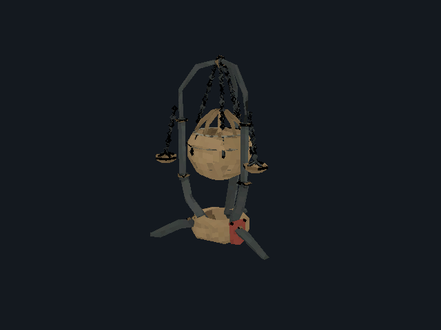](images/field-pilots-r9/censer-of-dread/gpu/damaged.png) | gpu / damaged | OVERVIEW_OR_HISTORICAL_STUDY | 640×480 |
| [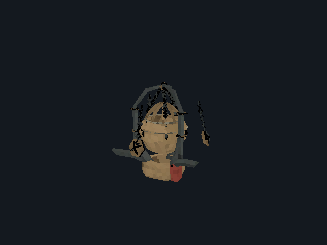](images/field-pilots-r9/censer-of-dread/gpu/deploying.png) | gpu / deploying | OVERVIEW_OR_HISTORICAL_STUDY | 640×480 |
| [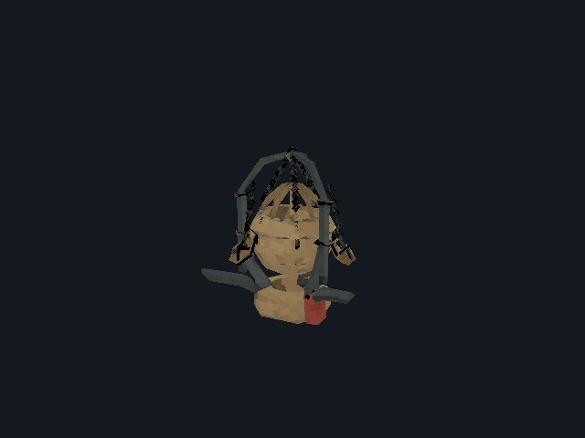](images/field-pilots-r9/censer-of-dread/gpu/destroyed.png) | gpu / destroyed | OVERVIEW_OR_HISTORICAL_STUDY | 640×480 |
| [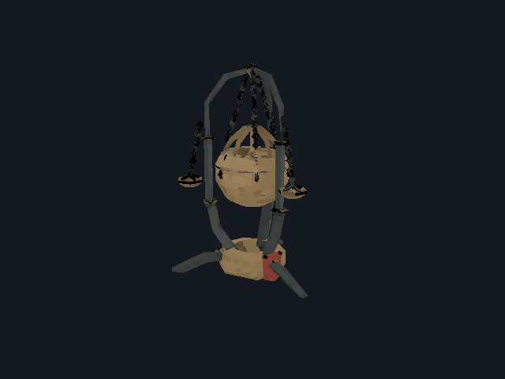](images/field-pilots-r9/censer-of-dread/gpu/expiring.png) | gpu / expiring | OVERVIEW_OR_HISTORICAL_STUDY | 640×480 |
| [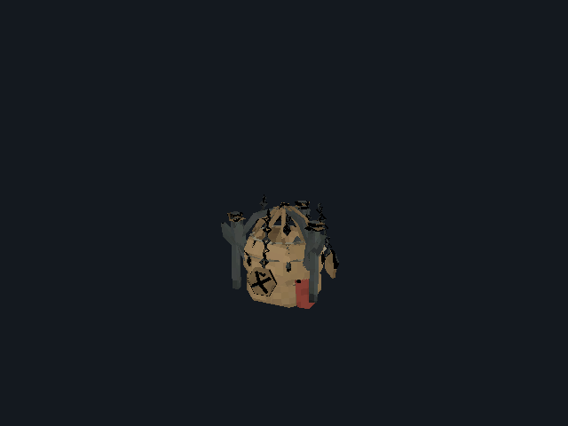](images/field-pilots-r9/censer-of-dread/gpu/impact.png) | gpu / impact | OVERVIEW_OR_HISTORICAL_STUDY | 640×480 |
| [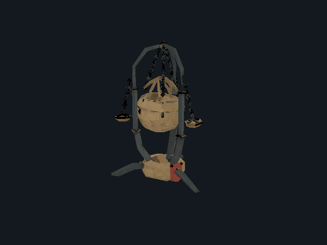](images/field-pilots-r9/censer-of-dread/gpu/operating.png) | gpu / operating | OVERVIEW_OR_HISTORICAL_STUDY | 640×480 |
| [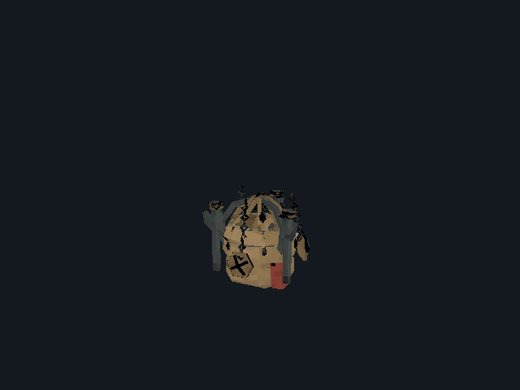](images/field-pilots-r9/censer-of-dread/gpu/packed.png) | gpu / packed | OVERVIEW_OR_HISTORICAL_STUDY | 640×480 |
| [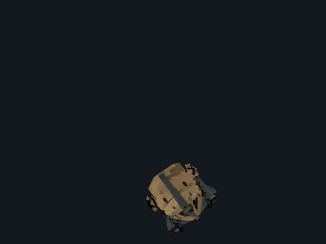](images/field-pilots-r9/censer-of-dread/gpu/thrown.png) | gpu / thrown | OVERVIEW_OR_HISTORICAL_STUDY | 640×480 |
| [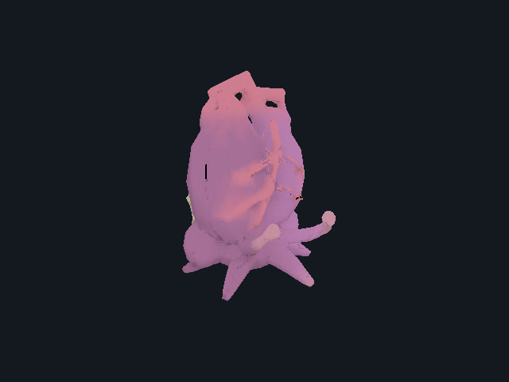](images/field-pilots-r9/regeneration-heart/gpu/active.png) | gpu / active | OVERVIEW_OR_HISTORICAL_STUDY | 640×480 |
| [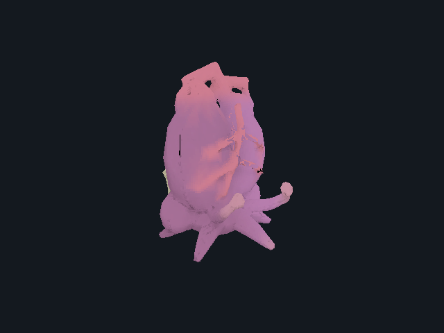](images/field-pilots-r9/regeneration-heart/gpu/damaged.png) | gpu / damaged | OVERVIEW_OR_HISTORICAL_STUDY | 640×480 |
| [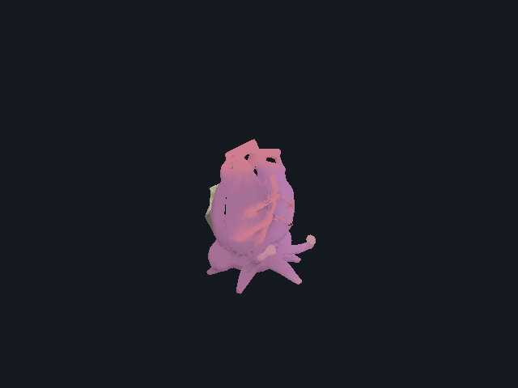](images/field-pilots-r9/regeneration-heart/gpu/deploying.png) | gpu / deploying | OVERVIEW_OR_HISTORICAL_STUDY | 640×480 |
| [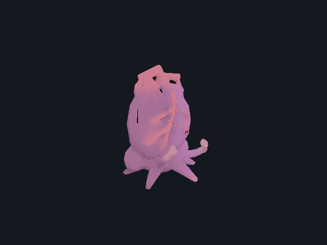](images/field-pilots-r9/regeneration-heart/gpu/destroyed.png) | gpu / destroyed | OVERVIEW_OR_HISTORICAL_STUDY | 640×480 |
|  | gpu / expiring | OVERVIEW_OR_HISTORICAL_STUDY | 640×480 |
| [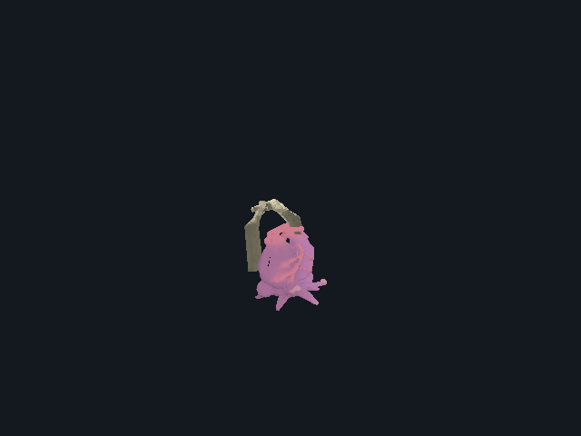](images/field-pilots-r9/regeneration-heart/gpu/impact.png) | gpu / impact | OVERVIEW_OR_HISTORICAL_STUDY | 640×480 |
| [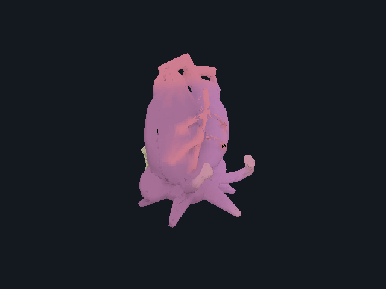](images/field-pilots-r9/regeneration-heart/gpu/operating.png) | gpu / operating | OVERVIEW_OR_HISTORICAL_STUDY | 640×480 |
| [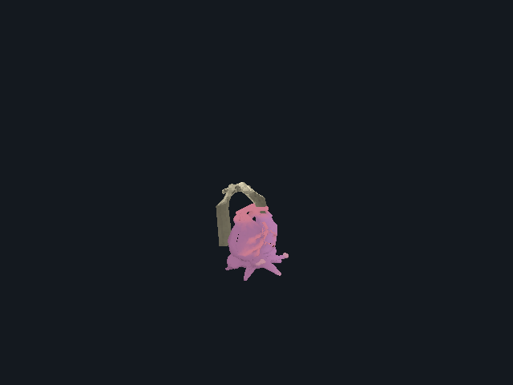](images/field-pilots-r9/regeneration-heart/gpu/packed.png) | gpu / packed | OVERVIEW_OR_HISTORICAL_STUDY | 640×480 |
| [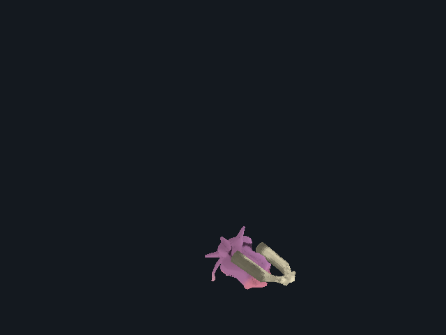](images/field-pilots-r9/regeneration-heart/gpu/thrown.png) | gpu / thrown | OVERVIEW_OR_HISTORICAL_STUDY | 640×480 |
|  | gpu / active | OVERVIEW_OR_HISTORICAL_STUDY | 640×480 |
| [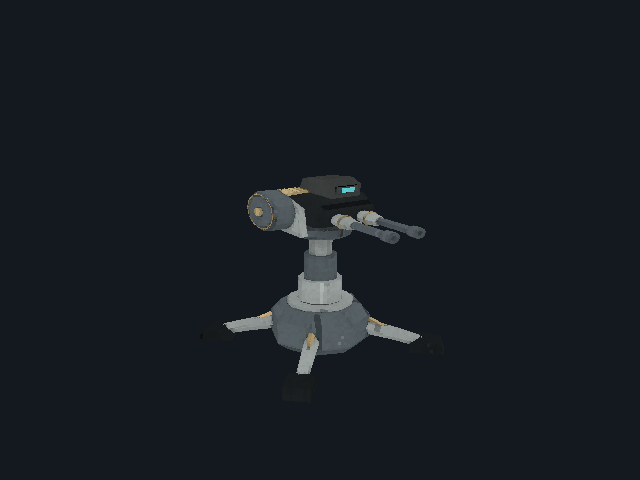](images/field-pilots-r9/sentry-mki/gpu/damaged.png) | gpu / damaged | OVERVIEW_OR_HISTORICAL_STUDY | 640×480 |
| [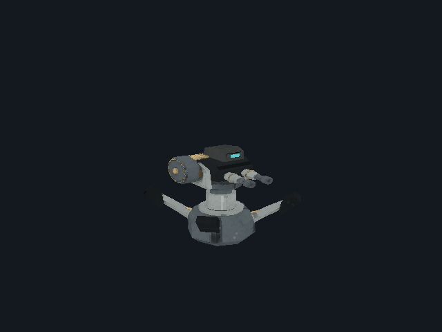](images/field-pilots-r9/sentry-mki/gpu/deploying.png) | gpu / deploying | OVERVIEW_OR_HISTORICAL_STUDY | 640×480 |
| [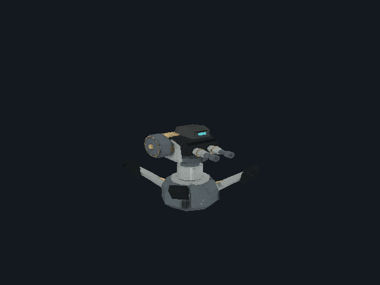](images/field-pilots-r9/sentry-mki/gpu/destroyed.png) | gpu / destroyed | OVERVIEW_OR_HISTORICAL_STUDY | 640×480 |
| [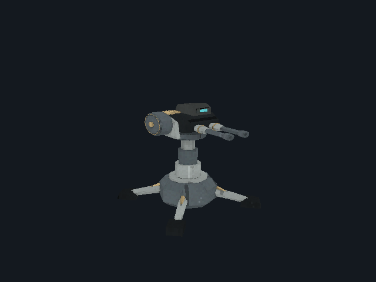](images/field-pilots-r9/sentry-mki/gpu/expiring.png) | gpu / expiring | OVERVIEW_OR_HISTORICAL_STUDY | 640×480 |
| [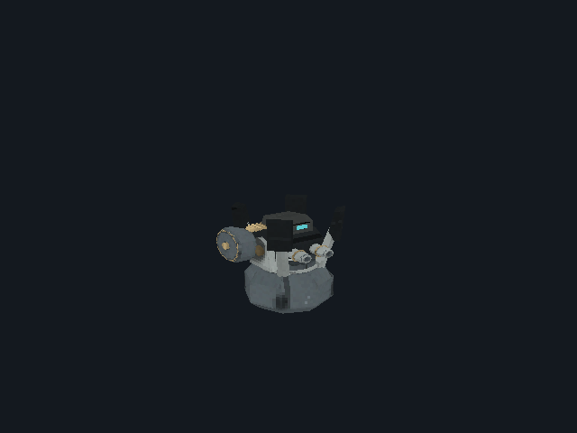](images/field-pilots-r9/sentry-mki/gpu/impact.png) | gpu / impact | OVERVIEW_OR_HISTORICAL_STUDY | 640×480 |
| [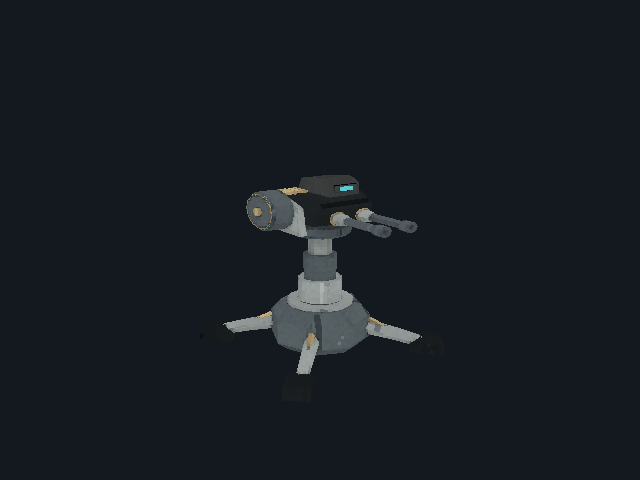](images/field-pilots-r9/sentry-mki/gpu/operating.png) | gpu / operating | OVERVIEW_OR_HISTORICAL_STUDY | 640×480 |
| [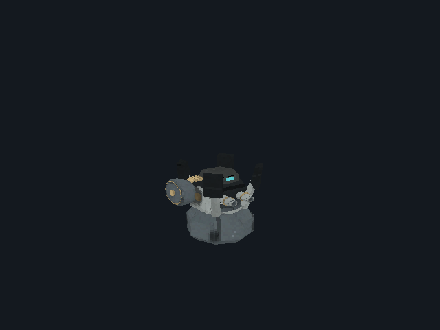](images/field-pilots-r9/sentry-mki/gpu/packed.png) | gpu / packed | OVERVIEW_OR_HISTORICAL_STUDY | 640×480 |
| [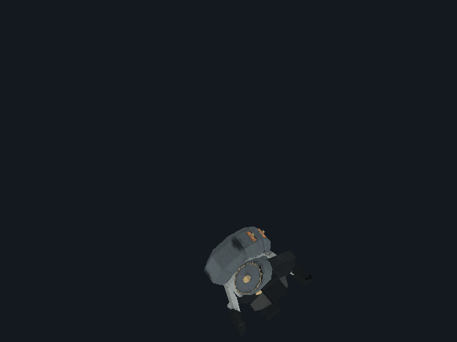](images/field-pilots-r9/sentry-mki/gpu/thrown.png) | gpu / thrown | OVERVIEW_OR_HISTORICAL_STUDY | 640×480 |
