# Superseded test renders

[Back to current gallery](README.md)

| Image | Asset / view | Earlier review status |
|---|---|---|
| [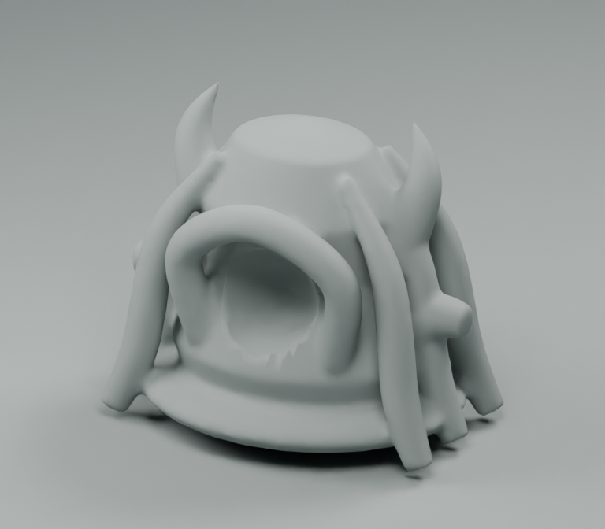](images/history/485e68400a59a6aa4dc5a3a58d2c62abce3cd102b208df179cc71fb1cdf8dbfe.png) | begotten-processor / clay | SUPERSEDED_UNREVIEWED |
| [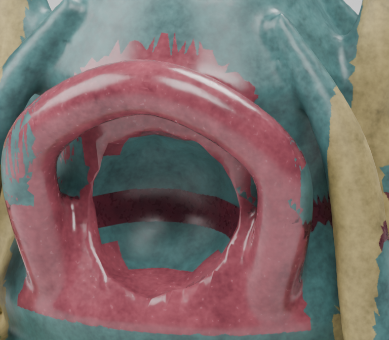](images/history/253db75afa2b2288f16bf310e3372f4ff588a75fb201bbffe87e824ebd2b5077.png) | begotten-processor / closeup | SUPERSEDED_UNREVIEWED |
| [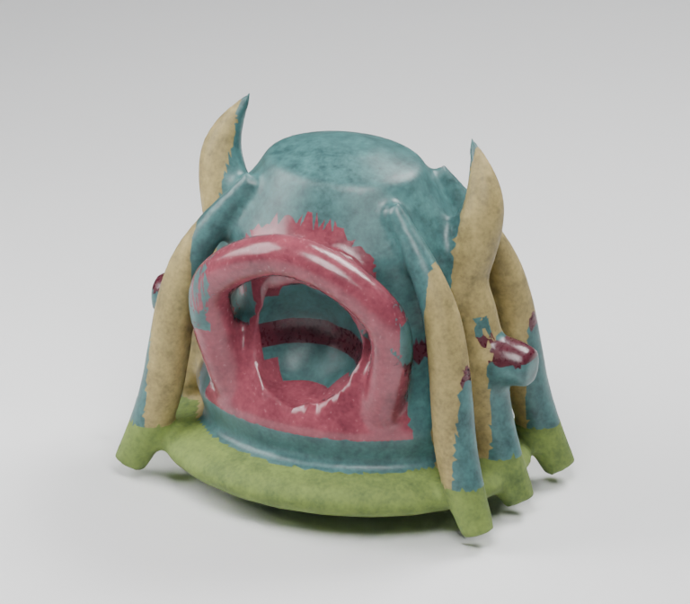](images/history/54c7a7d00961556a6bb53b56aad7e37d42ccc550be2a737bd04ad4ce0a29e4e5.png) | begotten-processor / front | SUPERSEDED_UNREVIEWED |
| [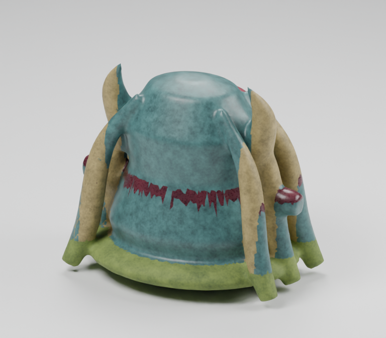](images/history/817acf69f974793c3702e7feb29fea9d669a4f58faf45cf1e00ed75e725c7c50.png) | begotten-processor / rear | SUPERSEDED_UNREVIEWED |
| [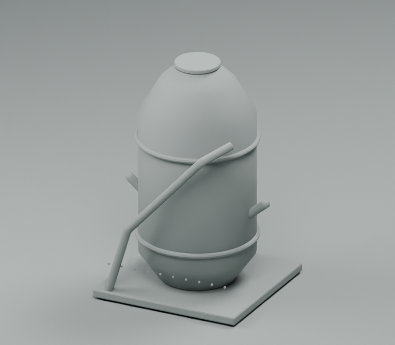](images/history/22e406f37d31600bc023a76d21631f93bfca6f169d2a7a635eecb3524dd9dfde.png) | penitent-fluid-tank / clay | SUPERSEDED_UNREVIEWED |
| [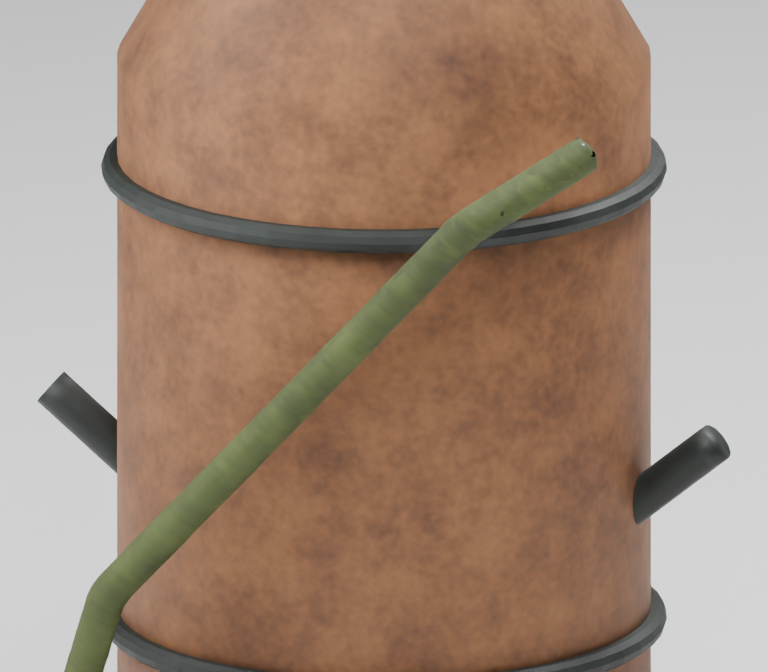](images/history/cb52406f55598acd1595bb85a8d1569b79ea15a4309d9d4cc1ea46e9f5691135.png) | penitent-fluid-tank / closeup | SUPERSEDED_UNREVIEWED |
| [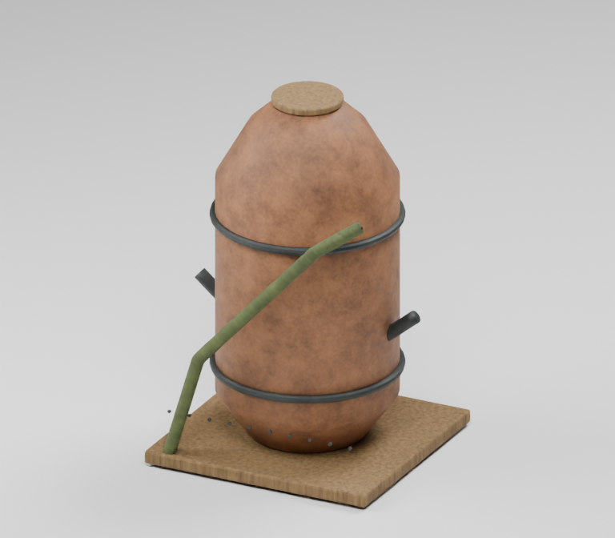](images/history/aeabb6125cfe475f2be59c0c85c1696c2d9bdc6643745a316ac011151c0c91f7.png) | penitent-fluid-tank / front | SUPERSEDED_UNREVIEWED |
| [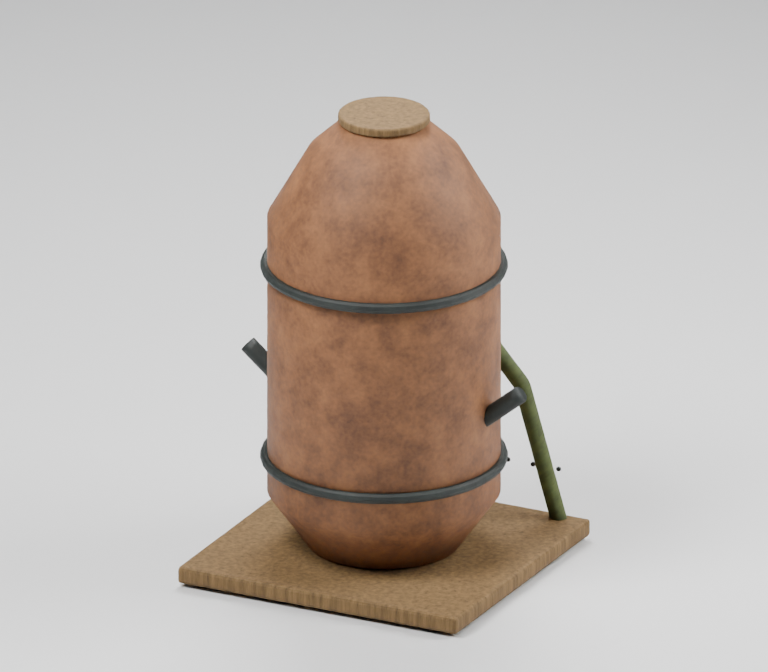](images/history/04aa463041ba6ce14faa5532637d1e7fa1b84f7ecee9e7d1f70459af7e463356.png) | penitent-fluid-tank / rear | SUPERSEDED_UNREVIEWED |
| [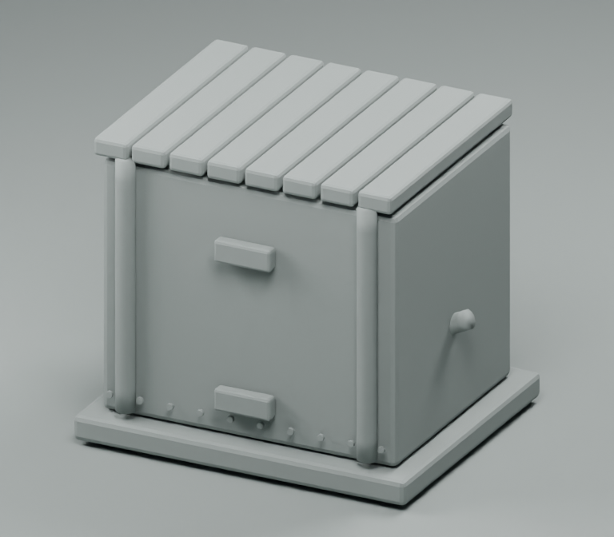](images/history/9b23111dcd0ecfb6743cc1bd8c0e023a89b5d6eb8e5122cef244f393c8fce077.png) | unraveled-dry-storage / clay | SUPERSEDED_UNREVIEWED |
| [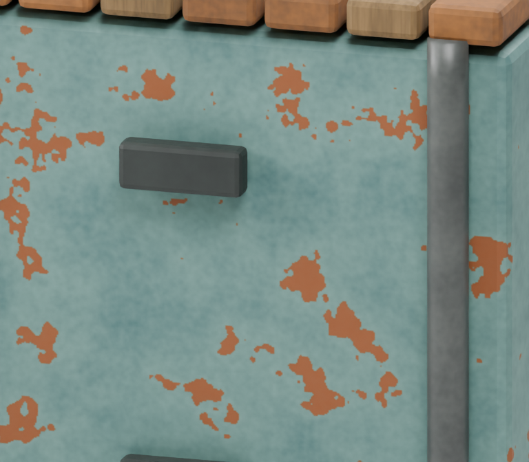](images/history/f9285f1a1475044674f31ba2c0e66310ace1738fb44e234d400ad7b380251f50.png) | unraveled-dry-storage / closeup | SUPERSEDED_UNREVIEWED |
| [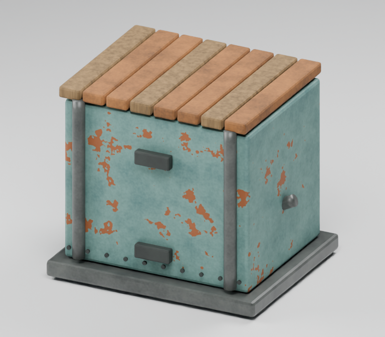](images/history/518ea4a5daaee0bc3dea29958987d9b0351c78662944b9b712388ec845571f54.png) | unraveled-dry-storage / front | SUPERSEDED_UNREVIEWED |
| [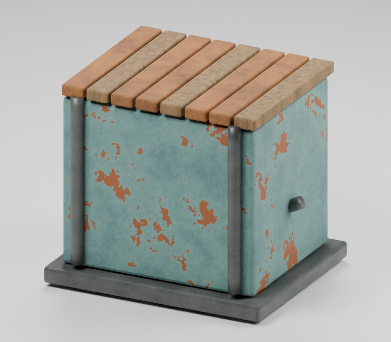](images/history/49fb342d30f6202c10920ffa769a6f6d52edd8c81b1b9a25e6f259ce10599b88.png) | unraveled-dry-storage / rear | SUPERSEDED_UNREVIEWED |
| [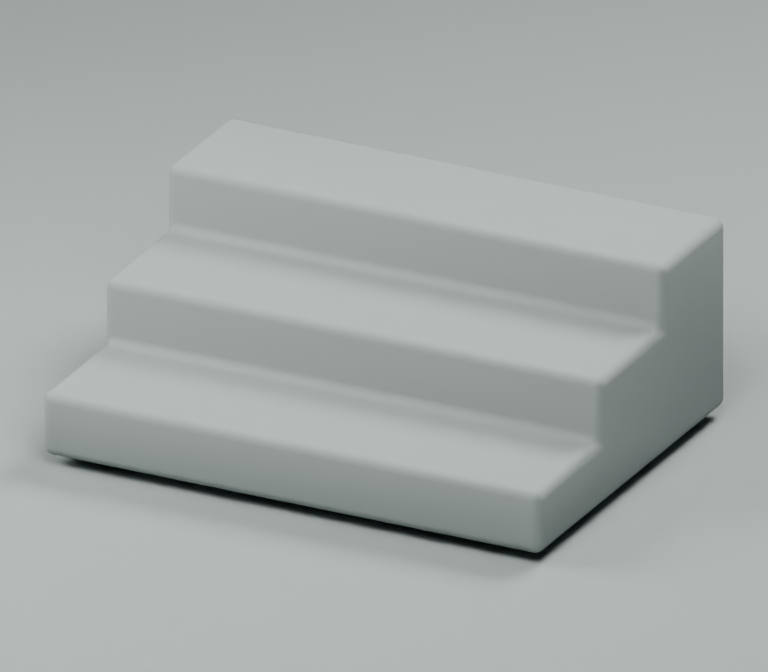](images/history/78dee9f230bce70e82e6749da1464853d85f5ec80830dc177460813ad4e5c21f.png) | begotten-foundation-stairs-h025 / clay | SUPERSEDED_REJECTED |
| [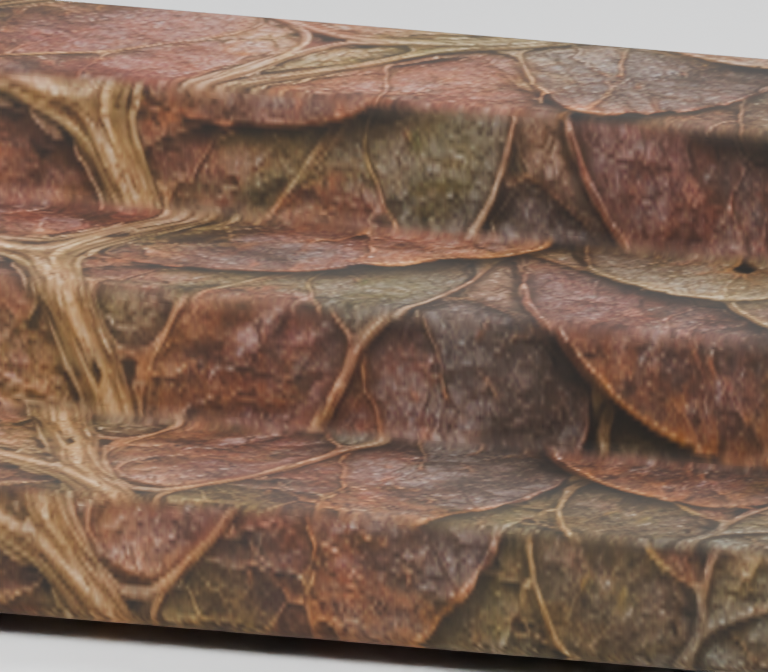](images/history/6a02ef89f4348c86e4aba190701a05cfe95e39e921586e12cfd7032636ba4fab.png) | begotten-foundation-stairs-h025 / closeup | SUPERSEDED_REJECTED |
| [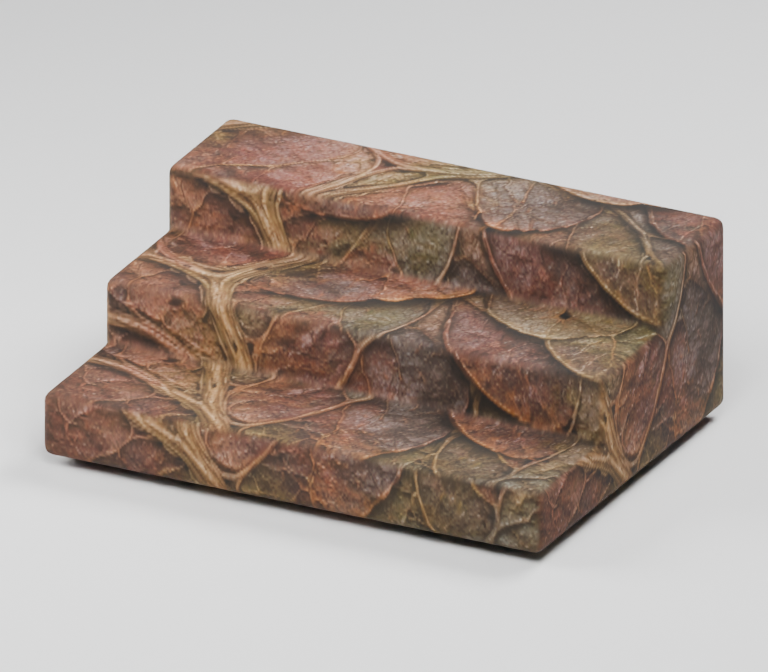](images/history/d4acb2e5f3f9da6b11155323a580550fc618c4fde24e0d1bdf376e9666c24f83.png) | begotten-foundation-stairs-h025 / front | SUPERSEDED_REJECTED |
| [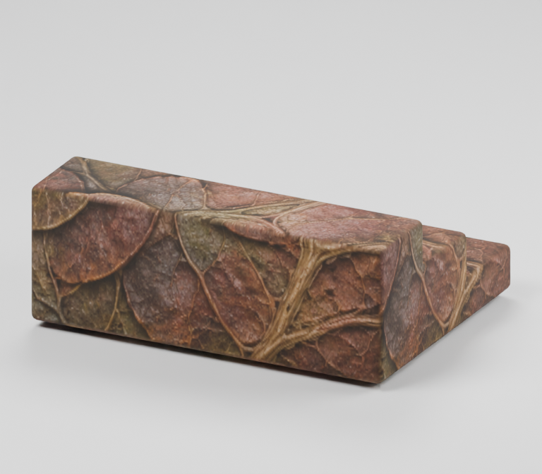](images/history/3f27f2922b2791379254b7c12b3ea08f695da088f20d37e7c679dd84e824acd8.png) | begotten-foundation-stairs-h025 / rear | SUPERSEDED_REJECTED |
| [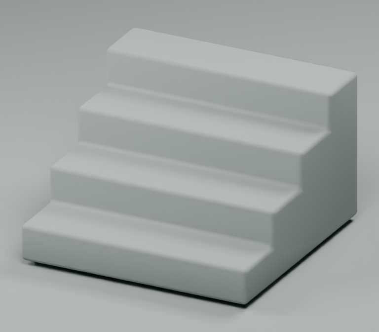](images/history/52d6e5b6e2450f80e70319e5a0c760eadf210773f3e788ae9c5924642eb7411c.png) | begotten-foundation-stairs-h050 / clay | SUPERSEDED_UNREVIEWED |
| [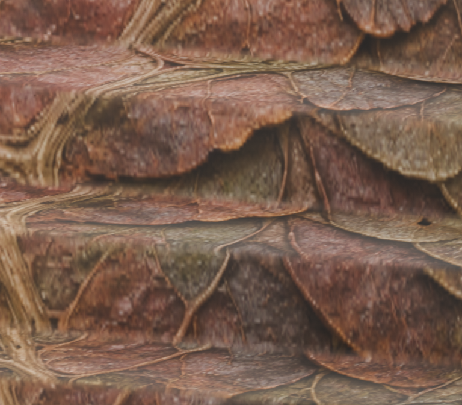](images/history/cd99cc0ab5453129336b7f2b88e0b1d2df8a7957352795e868a79cd935d43546.png) | begotten-foundation-stairs-h050 / closeup | SUPERSEDED_UNREVIEWED |
| [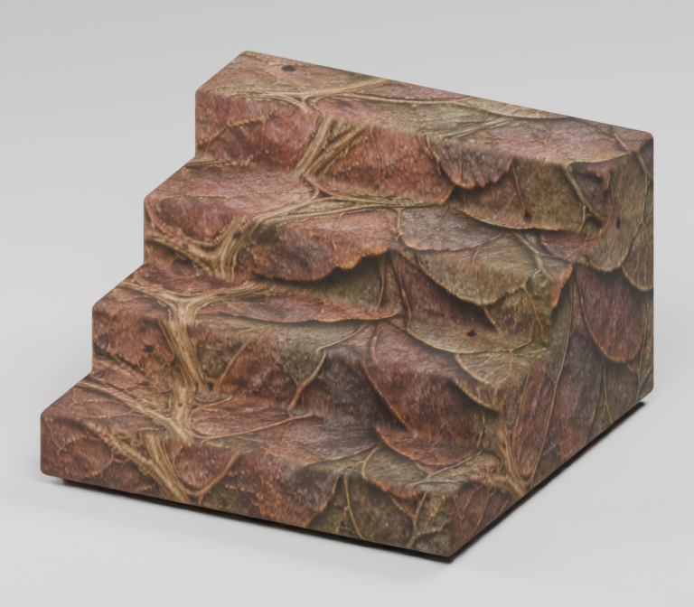](images/history/0b2783fc358218082c0a12ea515cf278bcab9cee9869c44a4bbd7030c987e365.png) | begotten-foundation-stairs-h050 / front | SUPERSEDED_UNREVIEWED |
| [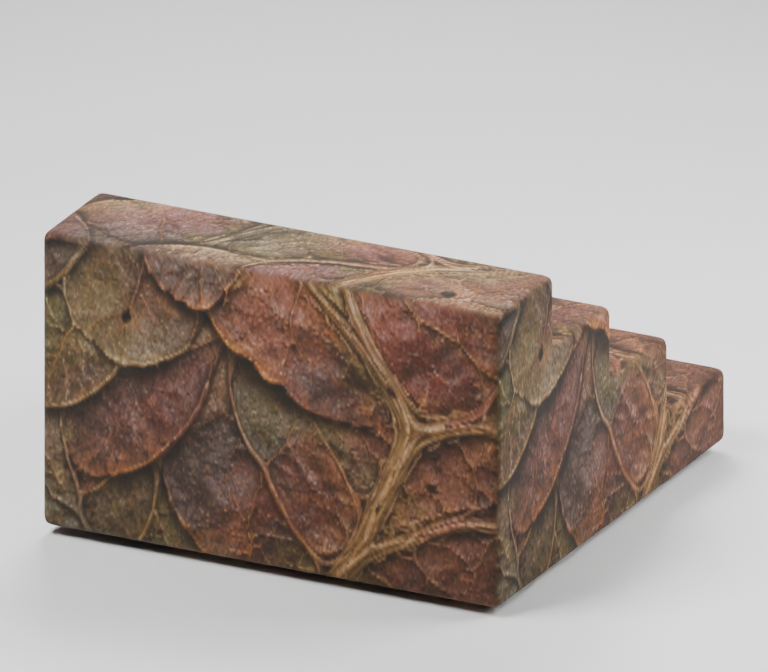](images/history/abf6630fcf6af580e45ef61bf51d26446e09e9dd751d65aef151642add05cfe3.png) | begotten-foundation-stairs-h050 / rear | SUPERSEDED_UNREVIEWED |
| [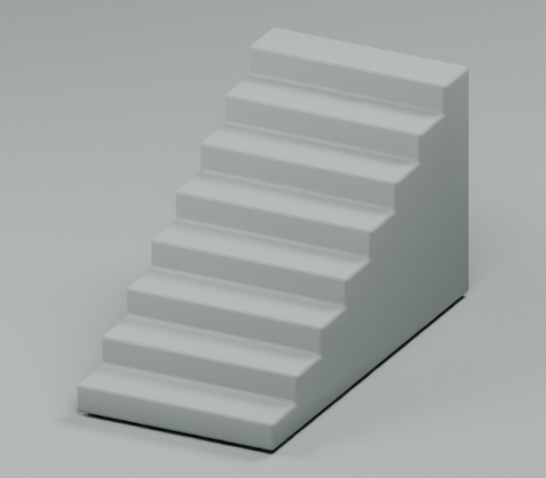](images/history/6888cc3bc921f89f929f20f124c931028148cb537716e14c0dbacc75d5ec2a0e.png) | begotten-foundation-stairs-h100 / clay | SUPERSEDED_UNREVIEWED |
| [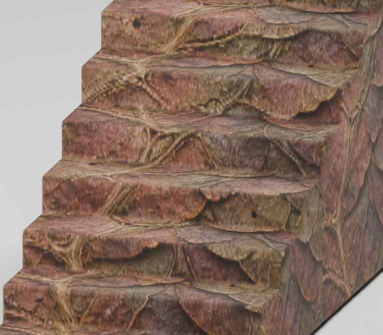](images/history/5d8bbea1967a77f57b6d06aa8cf961808ec9e48eb6a3db667747e1296e0ed7e2.png) | begotten-foundation-stairs-h100 / closeup | SUPERSEDED_UNREVIEWED |
| [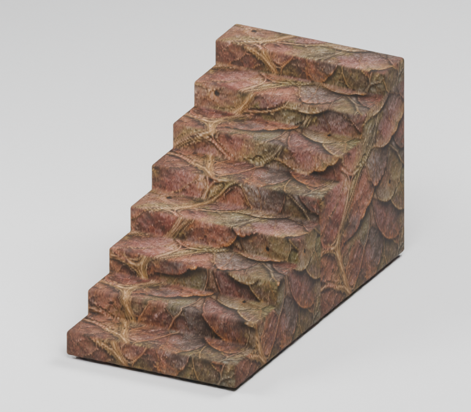](images/history/bce6dcc90112fc0da44438c39be70b2a9730e8378c8675efc87eb2ebbc06360c.png) | begotten-foundation-stairs-h100 / front | SUPERSEDED_UNREVIEWED |
| [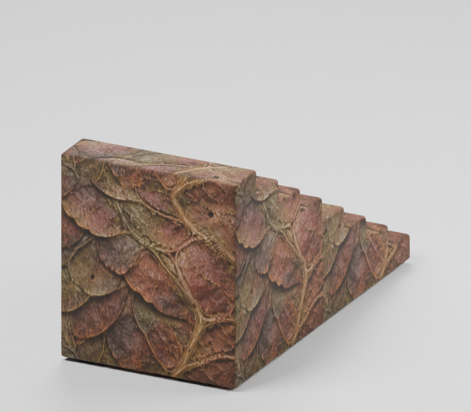](images/history/a4d838e4aa1409006f049a3b2659f08baa6db9ca3c7fc88754eddeb49a5a1b90.png) | begotten-foundation-stairs-h100 / rear | SUPERSEDED_UNREVIEWED |
| [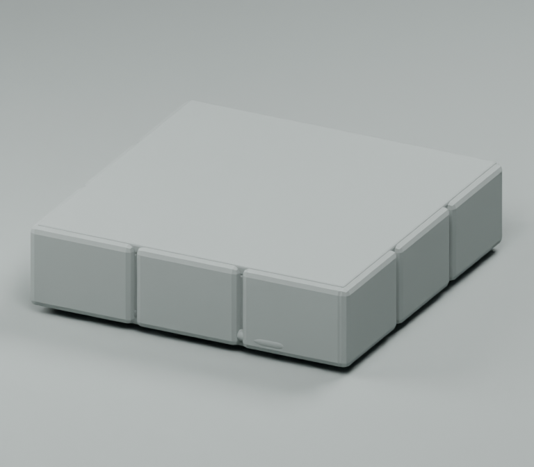](images/history/4a4cd22c2a2c43e9cf47b3ed06a86cd8e43fb7f3a08037733e71247dfacebdc5.png) | penitent-foundation-1x1-h025 / clay | SUPERSEDED_UNREVIEWED |
| [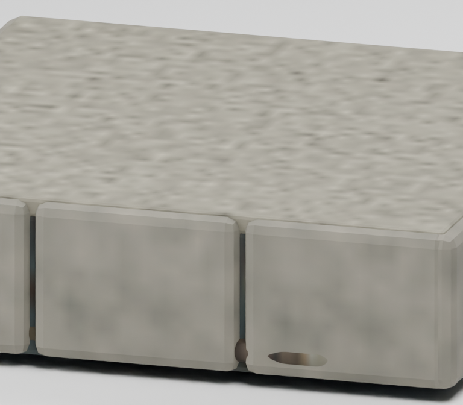](images/history/9f0cf2869e76d3ec1816c6b0aeb850e415fb2444894daf7aa984c552e69da889.png) | penitent-foundation-1x1-h025 / closeup | SUPERSEDED_UNREVIEWED |
| [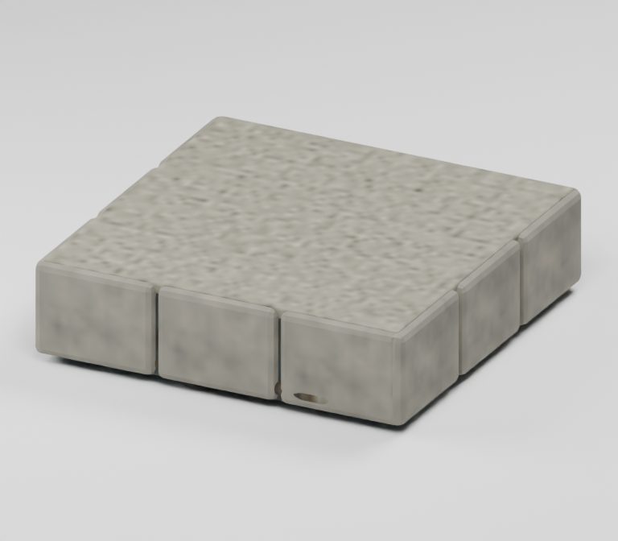](images/history/f7836e661b227b004b23083699edee01ed9b8de203550e22557e23557c51cf57.png) | penitent-foundation-1x1-h025 / front | SUPERSEDED_UNREVIEWED |
| [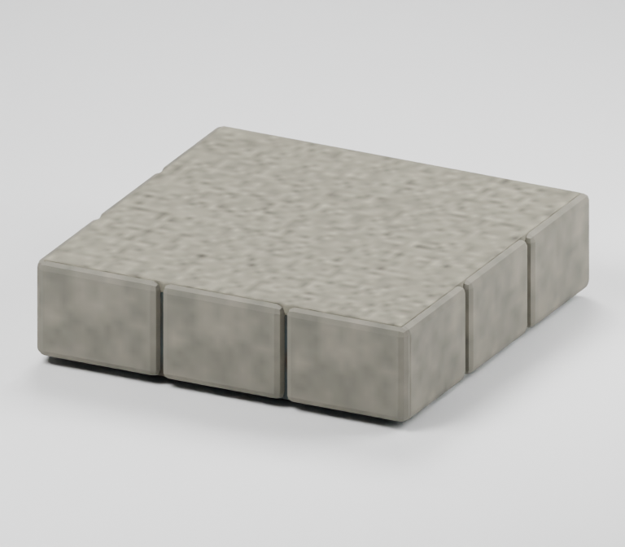](images/history/b18d826542ad412587e11c52a19300789ddebb515fa8d7d5ed3aa6cbfa8feb81.png) | penitent-foundation-1x1-h025 / rear | SUPERSEDED_UNREVIEWED |
| [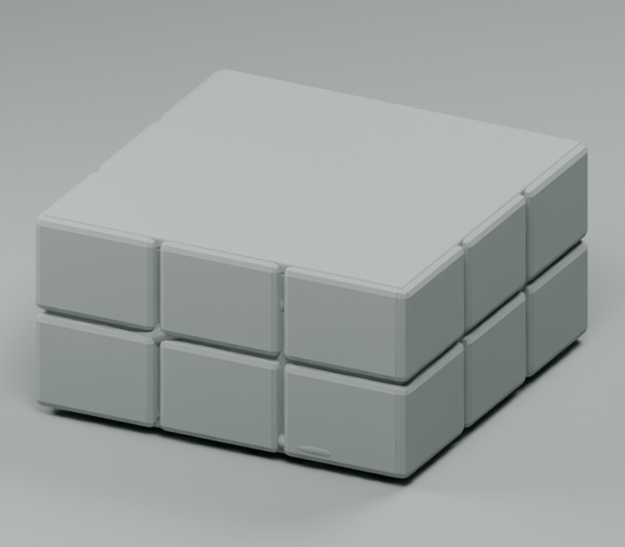](images/history/df640a524a8025f79e74e03bd847f7fc99621f1f634534411679a1607c7250ff.png) | penitent-foundation-1x1-h050 / clay | SUPERSEDED_REJECTED |
| [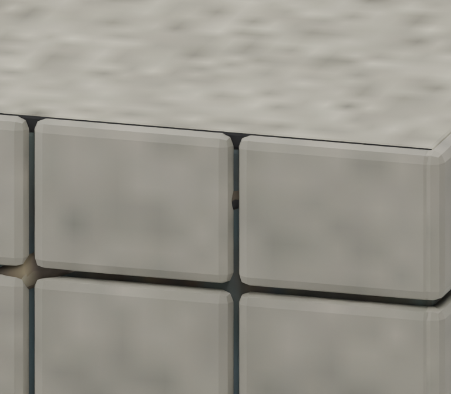](images/history/cd808d823312425e9b731e442a647382c254bf6cc392b63db5bfb9755c7bc897.png) | penitent-foundation-1x1-h050 / closeup | SUPERSEDED_REJECTED |
| [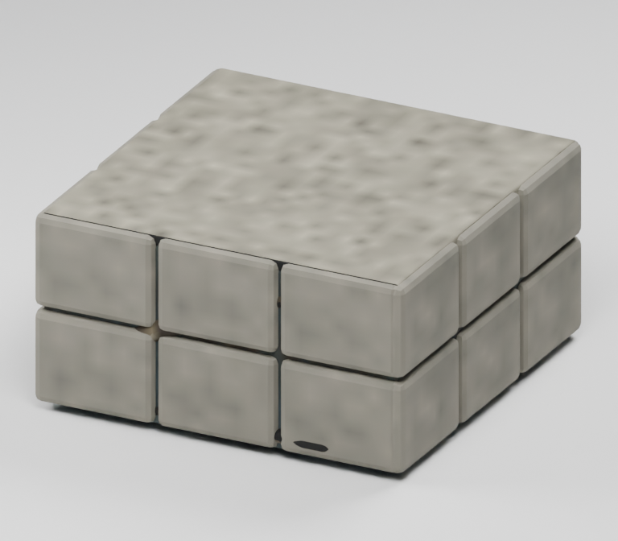](images/history/051b26475d7ff40217b9091ca733185e2f59954c5da416015669ea2c6d144fbe.png) | penitent-foundation-1x1-h050 / front | SUPERSEDED_REJECTED |
| [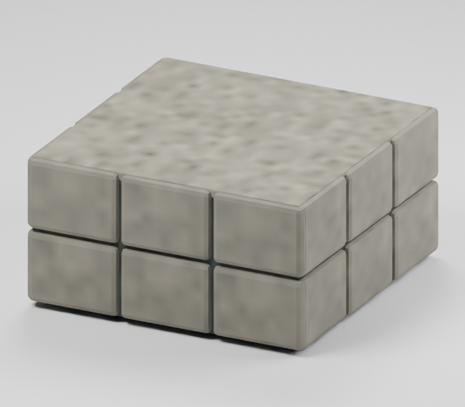](images/history/8ad51ae1ee33a74ab4a6930f50cf9137023414998c4ce55b79af1696af9af6f8.png) | penitent-foundation-1x1-h050 / rear | SUPERSEDED_REJECTED |
| [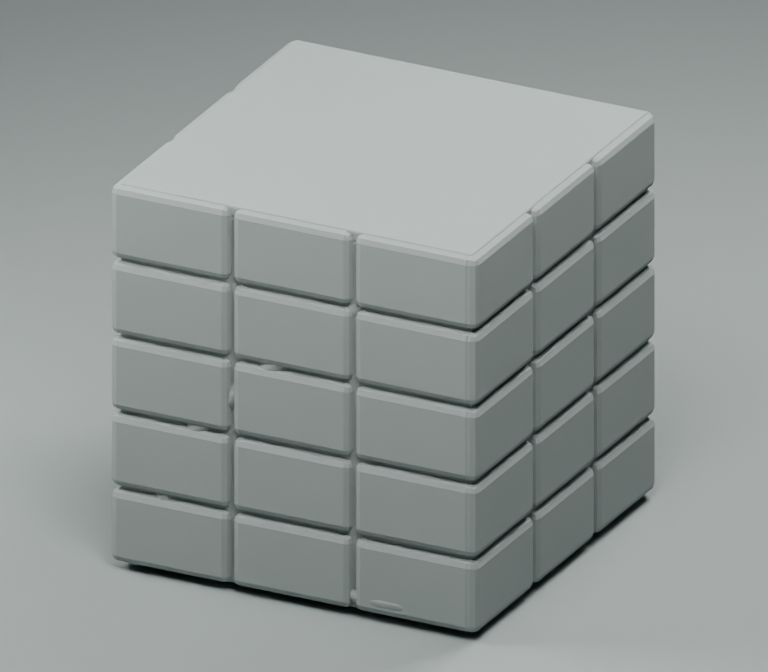](images/history/1211080472d4965a816b2fb196b1f34991a5952b21a5e896a5aeb74f1dff023f.png) | penitent-foundation-1x1-h100 / clay | SUPERSEDED_UNREVIEWED |
|  | penitent-foundation-1x1-h100 / closeup | SUPERSEDED_UNREVIEWED |
| [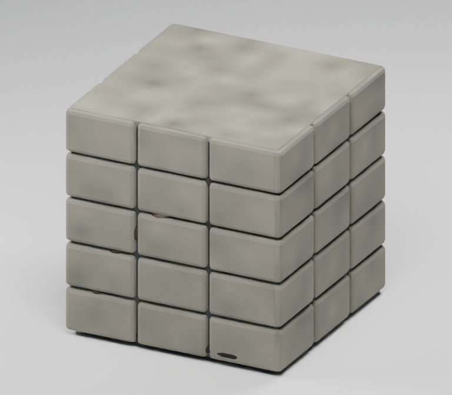](images/history/b1c2f43cfb77b830da26d4995f87132a38a55f0dc59d093b8ffa21b3eaa876ca.png) | penitent-foundation-1x1-h100 / front | SUPERSEDED_UNREVIEWED |
| [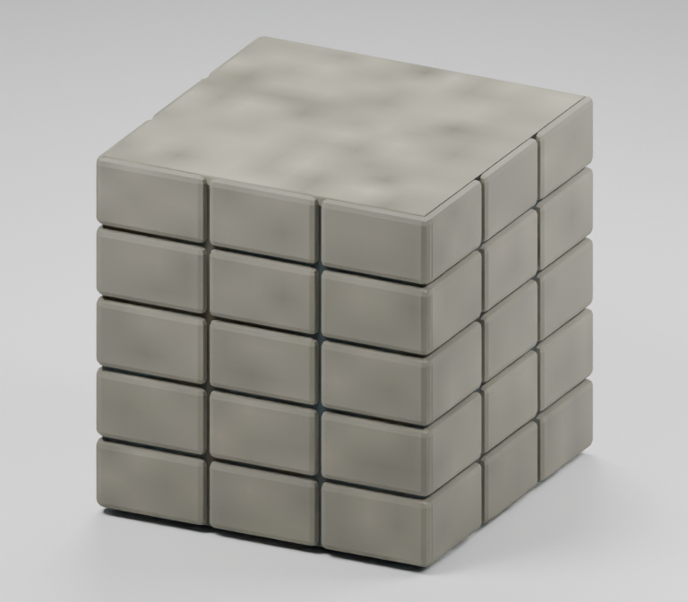](images/history/08b1f2c4fc31b632e53fffd5e7a9ba1f3443f0f4f09d6d23338d41fc49b5975d.png) | penitent-foundation-1x1-h100 / rear | SUPERSEDED_UNREVIEWED |
| [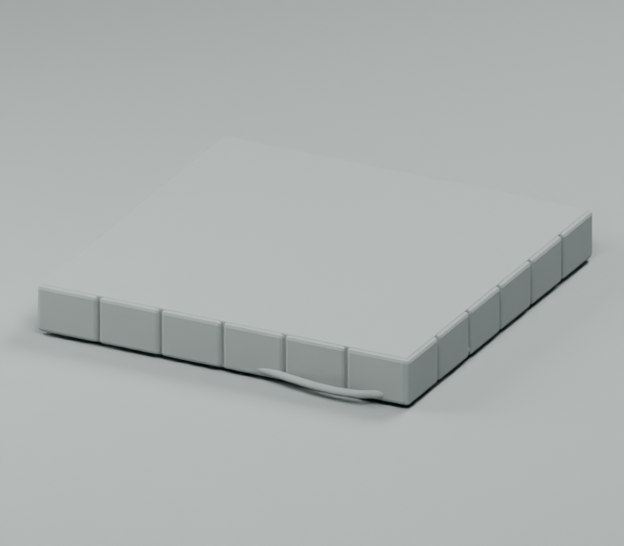](images/history/2046eacb66f2ce7b1df29c471e1e232244e8a23e1d88209f95e2e905dfd5bacd.png) | penitent-foundation-2x2-h025 / clay | SUPERSEDED_UNREVIEWED |
| [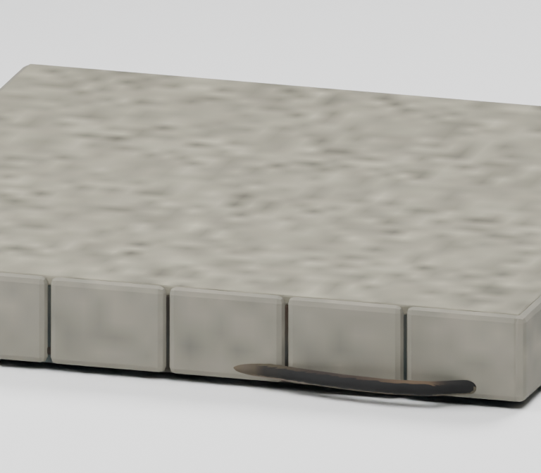](images/history/b7b95eed13c9f523d334ec8c0fecc92d7387ebf3c1f690f65ef11ed3085e7dbd.png) | penitent-foundation-2x2-h025 / closeup | SUPERSEDED_UNREVIEWED |
| [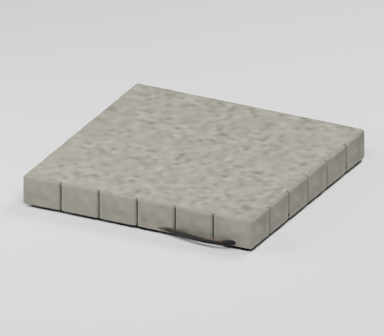](images/history/2bfb63cb7dc02eefd6907701afc5f0acb2889c9fe838296e1db75ce1c9a606a0.png) | penitent-foundation-2x2-h025 / front | SUPERSEDED_UNREVIEWED |
| [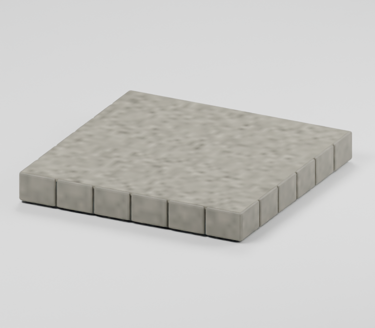](images/history/b8d4f9f361251b01133c68335d82a231c176d44a27b056f83b72b4429fc38df9.png) | penitent-foundation-2x2-h025 / rear | SUPERSEDED_UNREVIEWED |
| [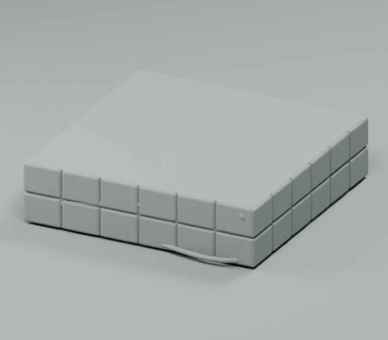](images/history/309879a7246e50cc0271f52d1a0b9f14db5119907aed83ac6b72ffe77ed196c3.png) | penitent-foundation-2x2-h050 / clay | SUPERSEDED_UNREVIEWED |
| [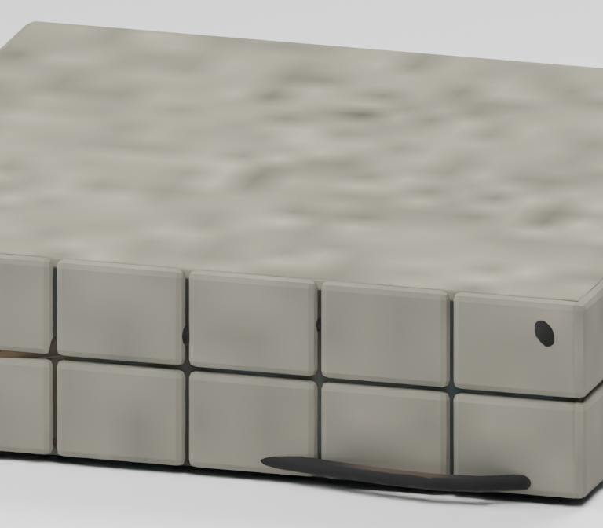](images/history/a0cfa64143cfd539a3a4da2181c8abad2c1d7d1571cbeea7a0468551b1b7b1f2.png) | penitent-foundation-2x2-h050 / closeup | SUPERSEDED_UNREVIEWED |
| [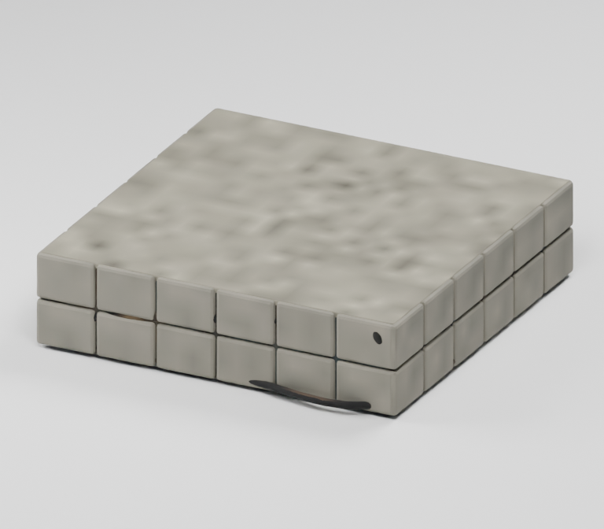](images/history/4db6e959220e54474b9e89e7b29c86b9c9c265ed007751d9269965c406d87a23.png) | penitent-foundation-2x2-h050 / front | SUPERSEDED_UNREVIEWED |
| [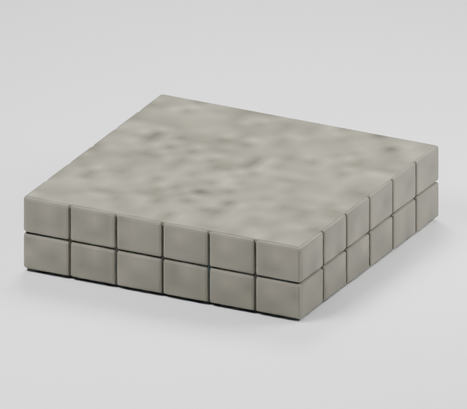](images/history/b52ec90035c0f1ab64add329ad8c7bb8a9a6718a6eaf5aa463bcd2b134d70a25.png) | penitent-foundation-2x2-h050 / rear | SUPERSEDED_UNREVIEWED |
| [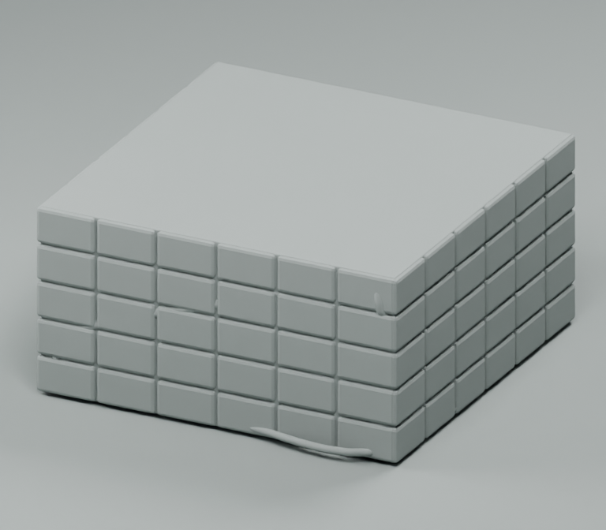](images/history/a308979fe66aaf8848b2ddec944dfee9e4504cf4b6b01809522a094d9539e561.png) | penitent-foundation-2x2-h100 / clay | SUPERSEDED_UNREVIEWED |
| [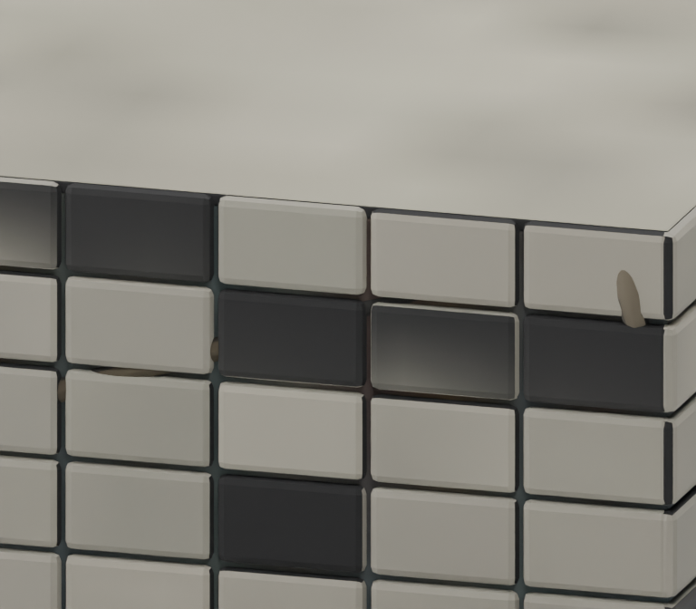](images/history/dee37ec67507fac3da90acca5df8fbeb1ca88ad823409052a57e9627b585dc5a.png) | penitent-foundation-2x2-h100 / closeup | SUPERSEDED_UNREVIEWED |
| [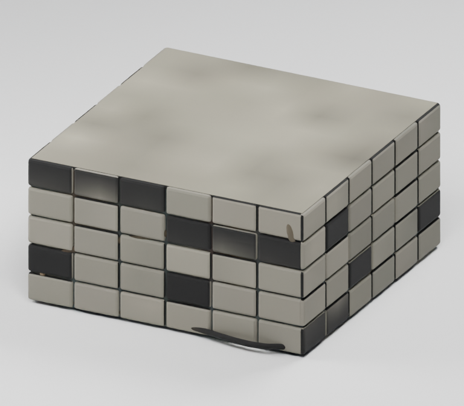](images/history/6547ab4bc7525131b393ebabd719926039837669d1e369afb88671c8e8a51b4d.png) | penitent-foundation-2x2-h100 / front | SUPERSEDED_UNREVIEWED |
| [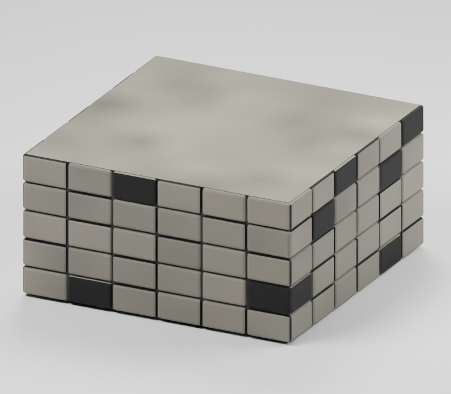](images/history/c8d9ff2d13cb5bbaa005c6dc482be090164cbed6986ffb95bd54135aad2aa44b.png) | penitent-foundation-2x2-h100 / rear | SUPERSEDED_UNREVIEWED |
| [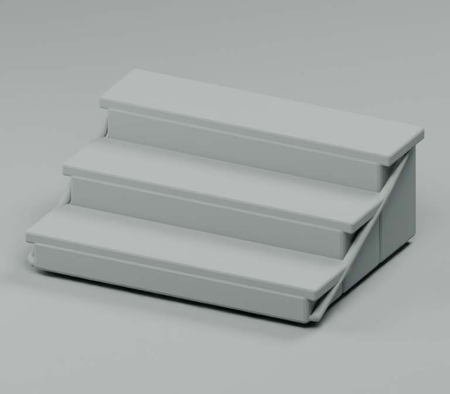](images/history/d7b8b4290e5573276a7b0c0b772b592493bdb072518468e7a12dc9ad20192fa4.png) | penitent-foundation-stairs-h025 / clay | SUPERSEDED_UNREVIEWED |
| [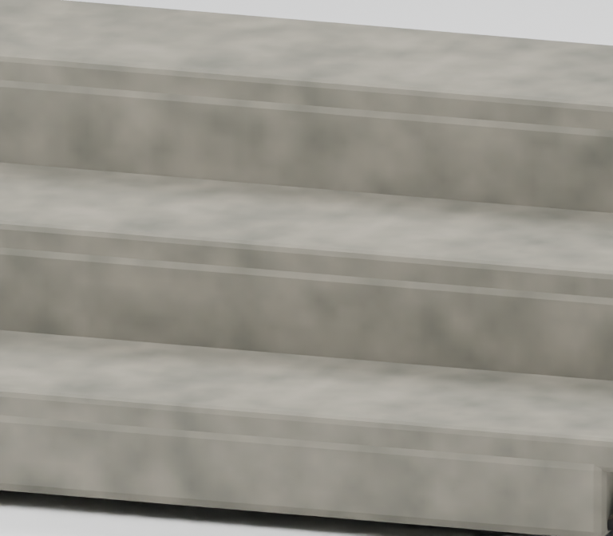](images/history/c7c1025330f173336780c640339dc644bf6a4e570bda1ba8397661ce6956ec47.png) | penitent-foundation-stairs-h025 / closeup | SUPERSEDED_UNREVIEWED |
| [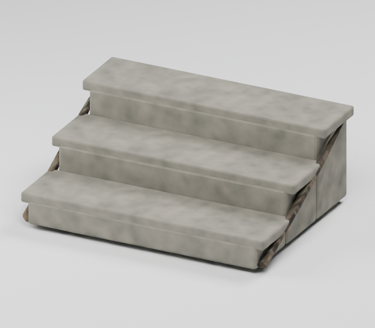](images/history/90fbd5eb82c4da75ad6ce3f055d2f990fa2959893c797a49142f2170d9200e0e.png) | penitent-foundation-stairs-h025 / front | SUPERSEDED_UNREVIEWED |
|  | penitent-foundation-stairs-h025 / rear | SUPERSEDED_UNREVIEWED |
|  | penitent-foundation-stairs-h050 / clay | SUPERSEDED_UNREVIEWED |
|  | penitent-foundation-stairs-h050 / closeup | SUPERSEDED_UNREVIEWED |
|  | penitent-foundation-stairs-h050 / front | SUPERSEDED_UNREVIEWED |
|  | penitent-foundation-stairs-h050 / rear | SUPERSEDED_UNREVIEWED |
|  | penitent-foundation-stairs-h100 / clay | SUPERSEDED_UNREVIEWED |
|  | penitent-foundation-stairs-h100 / closeup | SUPERSEDED_UNREVIEWED |
|  | penitent-foundation-stairs-h100 / front | SUPERSEDED_UNREVIEWED |
|  | penitent-foundation-stairs-h100 / rear | SUPERSEDED_UNREVIEWED |
|  | penitent-foundation-1x1-h025 / clay | SUPERSEDED_REJECTED |
|  | penitent-foundation-1x1-h025 / closeup | SUPERSEDED_REJECTED |
|  | penitent-foundation-1x1-h025 / front | SUPERSEDED_REJECTED |
|  | penitent-foundation-1x1-h025 / rear | SUPERSEDED_REJECTED |
|  | penitent-foundation-1x1-h050 / clay | SUPERSEDED_REJECTED |
|  | penitent-foundation-1x1-h050 / closeup | SUPERSEDED_REJECTED |
|  | penitent-foundation-1x1-h050 / front | SUPERSEDED_REJECTED |
|  | penitent-foundation-1x1-h050 / rear | SUPERSEDED_REJECTED |
|  | penitent-foundation-1x1-h100 / clay | SUPERSEDED_REJECTED |
|  | penitent-foundation-1x1-h100 / closeup | SUPERSEDED_REJECTED |
|  | penitent-foundation-1x1-h100 / front | SUPERSEDED_REJECTED |
|  | penitent-foundation-1x1-h100 / rear | SUPERSEDED_REJECTED |
|  | penitent-foundation-2x2-h025 / clay | SUPERSEDED_REJECTED |
|  | penitent-foundation-2x2-h025 / closeup | SUPERSEDED_REJECTED |
|  | penitent-foundation-2x2-h025 / front | SUPERSEDED_REJECTED |
|  | penitent-foundation-2x2-h025 / rear | SUPERSEDED_REJECTED |
|  | penitent-foundation-2x2-h050 / clay | SUPERSEDED_REJECTED |
|  | penitent-foundation-2x2-h050 / closeup | SUPERSEDED_REJECTED |
|  | penitent-foundation-2x2-h050 / front | SUPERSEDED_REJECTED |
|  | penitent-foundation-2x2-h050 / rear | SUPERSEDED_REJECTED |
|  | penitent-foundation-2x2-h100 / clay | SUPERSEDED_REJECTED |
|  | penitent-foundation-2x2-h100 / closeup | SUPERSEDED_REJECTED |
|  | penitent-foundation-2x2-h100 / front | SUPERSEDED_REJECTED |
|  | penitent-foundation-2x2-h100 / rear | SUPERSEDED_REJECTED |
|  | penitent-raised-foundation-demo / clay | SUPERSEDED_UNREVIEWED |
|  | penitent-raised-foundation-demo / closeup | SUPERSEDED_UNREVIEWED |
|  | penitent-raised-foundation-demo / front | SUPERSEDED_UNREVIEWED |
|  | penitent-raised-foundation-demo / rear | SUPERSEDED_UNREVIEWED |
|  | faction-foundations / penitent-clay | SUPERSEDED_OVERVIEW_OR_HISTORICAL_STUDY |
|  | faction-foundations / penitent-closeup | SUPERSEDED_OVERVIEW_OR_HISTORICAL_STUDY |
|  | penitent-foundation-2x2-h100 / clay | SUPERSEDED_REJECTED |
|  | penitent-foundation-2x2-h100 / closeup | SUPERSEDED_REJECTED |
|  | penitent-foundation-2x2-h100 / front | SUPERSEDED_REJECTED |
|  | penitent-foundation-2x2-h100 / rear | SUPERSEDED_REJECTED |
|  | faction-foundations / penitent-front | SUPERSEDED_OVERVIEW_OR_HISTORICAL_STUDY |
|  | faction-foundations / penitent-rear | SUPERSEDED_OVERVIEW_OR_HISTORICAL_STUDY |
|  | faction-foundations / preview | SUPERSEDED_OVERVIEW_OR_HISTORICAL_STUDY |
