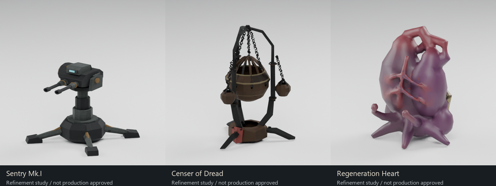

# Field equipment pilot refinement checkpoint

**Status: three refined studies; no production approval or promotion.**

The original 21-item batch remains rejected. These pilots establish separate mechanical, religious and biological construction methods. They are not a claim that the roster is complete.

## Sentry Mk.I

Replaced the cuboid-on-stick construction with an armored cassette, four retracting hinged outriggers and shaped ground shoes, a nested telescoping mast, a yaw bearing, elevation fork/trunnions, guided twin barrels with actual bore openings, an ammunition drum and indexed feed, an ejection recess and a protected sensor window. The packed form uses component translation/rotation, not root scaling.

The exported model has **2,556 triangles** and a measured packed envelope of **0.511 × 0.485 × 0.495 m**. The exported deployment sequence visibly lowers the feet, raises the support and extends the barrels. The operating sequence has guided recoil and an indexed ammunition feed. Recoil is subtle at roster distance; a larger close-range motion review remains useful. More authored wear, mechanism detailing and damage-state work remain. This is a viable refinement direction, not accepted final art.

## Censer of Dread

Replaced the recolored exhaust pipes with a three-legged iron cradle, nested wrought supports, a hollow bronze incense bowl with open lid sectors, closed interlinked chain geometry, smaller hanging vessels and a pinned cloth strip. Actual bowl walls and bands were retained after the simplification pass damaged their appearance. The operational lid opens upward and returns; the suspension swings independently.

The exported model has **4,206 triangles**, **706 above** the approximate 3,500 target. The chain links and hollow vessels account for the retained detail. This is a documented study exception requiring an LOD/part-count decision before runtime acceptance. The packed envelope is approximately **0.549 × 0.499 × 0.533 m**, also above the preferred 0.5 m extent. Timed deployment frames show the support and hanging assembly emerging, but envelope measurements do not prove that all internal nesting is collision-free. That remains a specific review task. Host-driven smoke is not authored yet.

## Regeneration Heart

Replaced the generic pod with unequal ventricular chambers, atrial masses, crossing great vessels, raised coronary branches, nutrient sacs, anchoring roots, a lower bone cradle and connected treatment tendrils. The tissue, vessels, roots and treatment appendages are actually united into one closed surface. The earlier abrupt red material boundaries were replaced with smoothly painted anatomical transitions baked into the atlas.

The exported model has **3,004 triangles** and a packed envelope of **0.370 × 0.471 × 0.420 m**. Three morph targets deform the connected tissue: left contraction, right contraction/treatment extension and the seed state. The deployment frames show the organ emerging from that seed; operating frames show chamber contraction and treatment-tip motion. The seed silhouette, material finish and relationship to the bone cradle still need art refinement. This has anatomical readability absent from the rejected pod, but is not production-approved.

## Evidence and validation

- Reimported the actual final GLBs for front, rear, closeup and neutral-clay renders.
- Inspected ten timed deployment and ten timed operating frames per pilot. GIFs and sequence sheets are under `previews/field-pilots-r4/<pilot>/`.
- Independent exported-geometry inspection measured complete UV and image-texture coverage, zero degenerate/nonfinite triangles and one closed connected cardiovascular body.
- Runtime tests check 27 nonempty clips, unique animation targets, absence of root-scale tracks, actual TRS/morph evaluation, host aiming, topology stability and sampled deployment bounds. All three remain above the ground plane through the sampled deployment sequence. These checks do not establish internal clearance or artistic acceptance.
- Existing 21-rig animation and thrown-equipment gameplay tests still pass. No live GPU playthrough is claimed.
- Original modeling projects and separately reimported animated Blender projects are retained. Each animated project contains nine imported actions.

The runtime evaluator now supports glTF per-vertex morph deltas and flattened scalar weight channels, following the [Khronos glTF specification](https://github.com/KhronosGroup/glTF/blob/main/specification/2.0/Specification.adoc). Skins and unsupported interpolation continue to fail explicitly.

## Next work

Keep production status separate from visual progress. Resolve the Censer's packing/budget issues, improve materials and detailed operating readability, then implement enduring damage/age states and the actual runtime collapse. Validate all transitions and events in the GPU game before promoting any pilot. Continue the other 18 items from the individual purpose review, with independently designed silhouettes and mechanisms.

Authoritative progress: `data/field-deployable-asset-index.json`. Technical measurements: `reports/field-pilot-technical-review.json`. Runtime checks: `reports/field-pilot-animation-tests.txt`.
